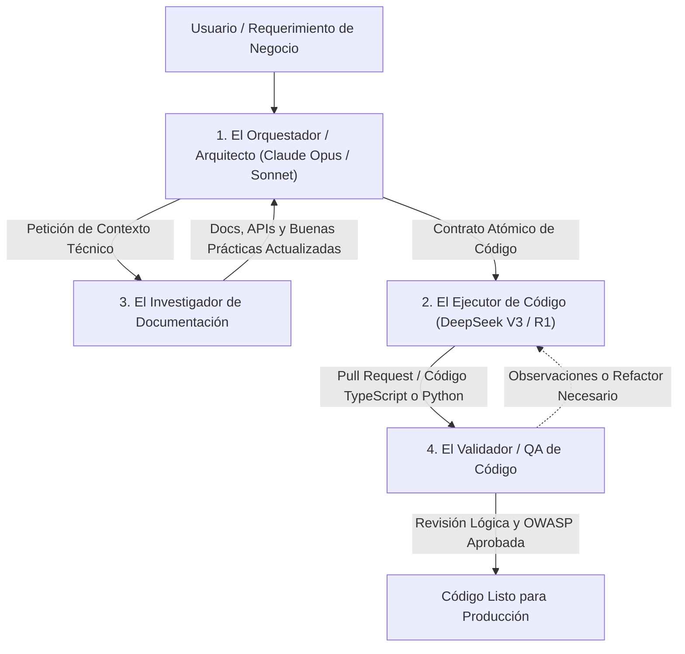
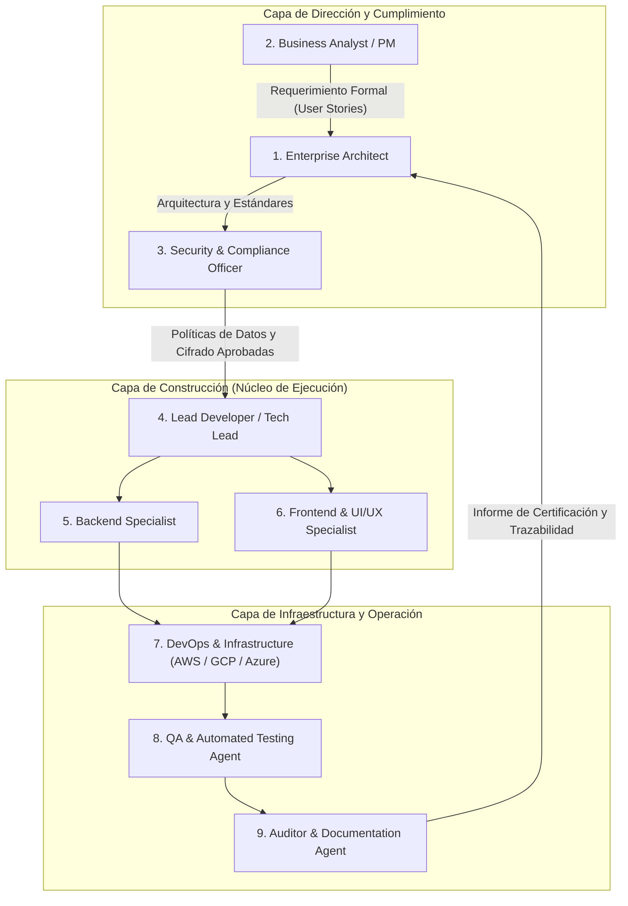

# 🏛️ El Imperio Agéntico: Arquitectura Dual (Lean Core + Enterprise Expansion)

> **Guía Oficial de Arquitectura de Sistemas Multi-Agente.**  
> Diseñada para los alumnos de **Vibecode Lab (Gen 1)** y extendida para implementaciones corporativas de alta exigencia (Cloud AWS / GCP / Azure, sector financiero y grandes empresas).

---

## 📌 Tabla de Contenidos

1. [El Principio de Elasticidad Agéntica](#1-el-principio-de-elasticidad-agéntica)
2. [Fase 1: El Núcleo Táctico Lean (4 Agentes Esenciales)](#2-fase-1-el-núcleo-táctico-lean-4-agentes-esenciales)
   - [Diagrama de Flujo del Squad Ágil](#diagrama-de-flujo-del-squad-ágil)
   - [Matriz de Roles y Especialidades](#matriz-de-roles-y-especialidades)
3. [Fase 2: La Capa de Expansión Corporativa (9 Agentes Enterprise)](#3-fase-2-la-capa-de-expansión-corporativa-9-agentes-enterprise)
   - [Arquitectura de Gobernanza y Separación de Poderes](#arquitectura-de-gobernanza-y-separación-de-poderes)
   - [Desglose de los 9 Roles Corporativos](#desglose-de-los-9-roles-corporativos)
4. [Estrategia Multi-Modelo: Sinergia Claude + DeepSeek](#4-estrategia-multi-modelo-sinergia-claude--deepseek)
5. [Guía de Implementación en IDE (Antigravity / Cursor / Claude Code)](#5-guía-de-implementación-en-ide)

---

## 1. El Principio de Elasticidad Agéntica

En el desarrollo asistido por Inteligencia Artificial, los equipos suelen caer en dos extremos destructivos:

1. **El Monolito Saturado**: Intentar resolver todo con un único mega-prompt o chat interminable, lo que provoca **fatiga de contexto (*context rot*)**, alucinaciones técnicas y pérdida de directivas críticas.
2. **La Hipertrofia Agéntica**: Sobredimensionar proyectos iniciales con 15 o 20 agentes interactuando sin control, disparando la latencia, el costo de tokens y generando bucles de aprobación improductivos.

**El Imperio Agéntico** soluciona esto con una **Arquitectura Dual y Elástica**:

- **Fase Lean (4 Agentes)**: Agilidad radical, prototipado ultra veloz y economía de tokens (\$0.001 - \$0.02 por iteración). Ideal para squads ágiles, validación de hipótesis y MVPs en Vibecode Lab.
- **Fase Enterprise (9 Agentes + Cloud)**: Activada automáticamente cuando el proyecto escala hacia entornos bancarios, corporativos o de misión crítica (ej. Banco BCI, aseguradoras, telecomunicaciones), integrando comités de ciberseguridad, DevOps multi-cloud y auditoría regulatoria.

---

## 2. Fase 1: El Núcleo Táctico Lean (4 Agentes Esenciales)

El Squad Ágil opera con 4 roles complementarios que combinan la alta capacidad de razonamiento estratégico de Claude con el volumen de código y bajo costo de DeepSeek.

### Diagrama de Flujo del Squad Ágil

### Matriz de Roles y Especialidades

| Agente | Modelo Recomendado | Misión Principal | Salida Concreta (*Deliverable*) |
| :--- | :--- | :--- | :--- |
| **1. Orquestador / Arquitecto** | Anthropic Claude 3.5 Sonnet / Opus | Recibe el requerimiento de negocio, descompone la tarea en un plan atómico modular y define contratos y tipos. **No genera código masivo**. | Plan de ejecución paso a paso, interfaces TypeScript y definición de límites. |
| **2. Especialista Ejecutor** | DeepSeek V3 / R1 | Escribe código modular, tipado, limpio y sin bloatware siguiendo estrictamente la especificación del Orquestador con costo mínimo. | Funciones, componentes UI, migraciones SQL o endpoints de API. |
| **3. Investigador de Documentación** | Gemini 2.5 Flash / Perplexity | Busca documentación oficial, repositorios y cambios de APIs para evitar bibliotecas deprecadas o patrones obsoletos. | Snippets de documentación verificada, sintaxis oficial y parámetros de librerías. |
| **4. Validador / QA de Código** | Claude 3.5 Sonnet / OpenAI o1 | Audita el código generado en búsqueda de fallos de seguridad (OWASP Top 10), edge-cases, tipos sueltos (`any`) y genera pruebas unitarias. | Checklist de seguridad, validación de linter y tests (Jest / Vitest / Pytest). |

---

## 3. Fase 2: La Capa de Expansión Corporativa (9 Agentes Enterprise)

Cuando el proyecto evoluciona hacia entornos regulados o grandes corporaciones, el núcleo ágil se encapsula dentro de una estructura formal de **separación de poderes**, cumplimiento y despliegue continuo en la nube.

### Arquitectura de Gobernanza y Separación de Poderes

### Desglose de los 9 Roles Corporativos

1. **Enterprise Architect (Arquitecto Corporativo)**: Define estándares macro, interoperabilidad, patrones de microservicios y compatibilidad con arquitecturas híbridas y nubes empresariales.
2. **Product Manager / Business Analyst**: Traduce objetivos comerciales y solicitudes de stakeholders en historias de usuario técnicas con criterios de aceptación auditables.
3. **Security & Compliance Officer**: Garantiza el cumplimiento de regulaciones bancarias e internacionales (PCI-DSS, GDPR, Ley Fintech, ISO 27001), cifrado de datos en reposo/tránsito y rotación de credenciales.
4. **Lead Developer / Orquestador Técnico**: Coordina los sprints diarios de desarrollo, asigna dependencias y resuelve bloqueos entre backend y frontend.
5. **Backend Specialist**: Diseña esquemas relacionales (PostgreSQL / Supabase / Cloud SQL), RPCs, colas de mensajes (Kafka / RabbitMQ / Redis) y transacciones de alta concurrencia.
6. **Frontend & UI/UX Specialist**: Implementa interfaces corporativas accesibles (WCAG 2.1 AA), sistemas de diseño corporativo y optimización de Core Web Vitals.
7. **DevOps & Infrastructure Engineer**: Automatiza pipelines CI/CD, aprovisionamiento de Infraestructura como Código (Terraform, CloudFormation) y orquestación con Docker / Kubernetes en AWS, Google Cloud o Microsoft Azure.
8. **QA & Automated Testing Agent**: Diseña y ejecuta suites de pruebas e2e (Playwright / Cypress), pruebas de carga (k6) y pruebas de regresión continua.
9. **Auditor & Documentation Agent**: Genera reportes técnicos, documentación de arquitectura (C4 Model, ADRs) y bitácoras de trazabilidad para comités de riesgo y auditorías externas.

---

## 4. Estrategia Multi-Modelo: Sinergia Claude + DeepSeek

Para lograr la máxima calidad técnica con la estructura de costos más competitiva del mercado:

- **Razonamiento Complejo y Arquitectura**: Modelos de frontera como **Anthropic Claude 3.5 Sonnet** o **Claude 3.5 Opus** para diseñar abstracciones y gobernar la seguridad.
- **Producción Masiva de Código**: Modelos como **DeepSeek V3 / R1** para generar miles de líneas de código sintácticamente perfecto a una fracción del costo tradicional.
- **Análisis de Gran Contexto**: **Google Gemini 2.5 Flash / Pro** con ventanas de hasta 1M tokens para auditar repositorios completos o normativas regulatorias de cientos de páginas.

---

## 5. Guía de Implementación en IDE

### En Google Antigravity / Cursor / Claude Code:
1. Para iteraciones diarias de tu SaaS o proyecto de Vibecode: activa el **Squad de 4 Agentes** definiendo los roles en tu archivo de configuración o reglas de proyecto.
2. Al presentar propuestas corporativas ante comités ejecutivos o clientes enterprise: adjunta este documento como respaldo de tu marco metodológico de desarrollo con IA.
