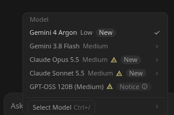
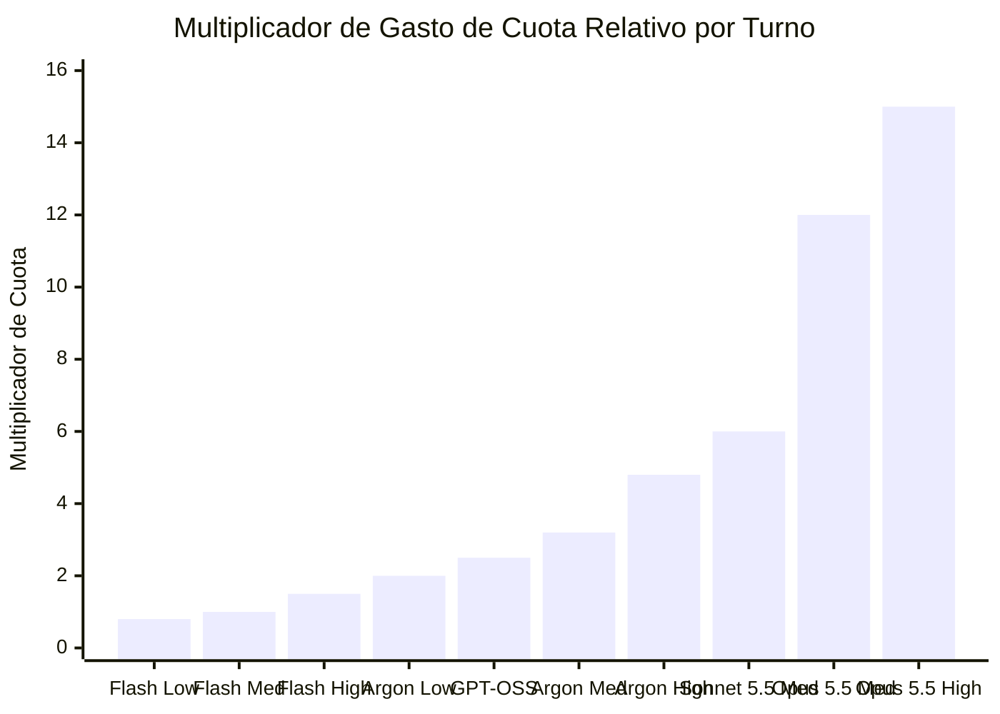
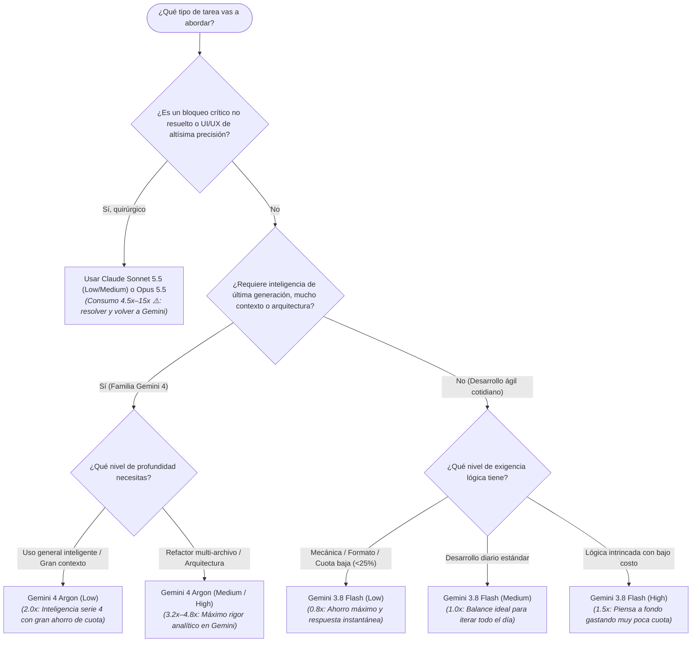

# Guía de Consumo de Tokens y Duración de Cuota por Modelo

Esta guía detalla el consumo relativo de tokens, cuota y niveles de razonamiento interno de los modelos actualizados disponibles en tu menú de Antigravity, explicando qué es cada modelo, por qué algunos agotan tu límite rápidamente, qué implica cada nivel (**Low**, **Medium**, **High**) y cuánto tiempo de trabajo rinde cada combinación.

| Menú de Selección Actualizado | Modelos Detectados |
| :---: | :--- |
|  | Selector activo de Antigravity con la nueva generación de modelos: **Gemini 4 Argon** (`New`), **Gemini 3.8 Flash**, **Claude Opus 5.5** (`New`), **Claude Sonnet 5.5** (`New`) y **GPT-OSS 120B (Medium)**. |

---

## 1. ¿Qué es cada Modelo Disponible en el Selector?

La actualización del menú incorpora la nueva generación de modelos de frontera de Google DeepMind y Anthropic, junto con controles granulares de pensamiento (`Low`, `Medium`, `High`):

### 1. 🚀 Gemini 4 Argon (`Low` / `Medium` / `High`) — `New`
* **¿Qué es?**: Es la nueva generación insignia de Google DeepMind en Antigravity (sucesor directo de la línea *Gemini 3.1 Pro* e integrado con arquitectura agéntica de cuarta generación). El nombre clave **Argon** identifica a esta versión optimizada para ingeniería de software profunda, manejo masivo de contexto y ejecución precisa de herramientas (MCP, terminal, subagentes).
* **Por qué destaca**: En su modo **`Low`**, ofrece razonamiento de frontera con una latencia bajísima y un consumo de cuota contenido, ideal para leer repositorios gigantes o trabajar horas sin sacrificar inteligencia arquitectónica. En **`Medium`** y **`High`**, despliega deducción multi-paso profunda para refactors complejos y diseño de sistemas.

### 2. ⚡ Gemini 3.8 Flash (`Low` / `Medium` / `High`)
* **¿Qué es?**: El motor de alta velocidad y eficiencia extrema de Google. Es el "caballo de batalla" cotidiano diseñado para iterar rápido, escribir componentes, crear scripts, correr pruebas y resolver tareas del día a día.
* **Por qué destaca**: Es la referencia base (**1.0x** en `Medium`) de consumo de cuota. Permite sesiones maratónicas de programación (8 a 16 horas continuas) con excelente adherencia a instrucciones.

### 3. 🧠 Claude Sonnet 5.5 (`Low` / `Medium` / `High`) — `New` ⚠️
* **¿Qué es?**: La nueva generación intermedia-alta de Anthropic (evolución directa de Claude Sonnet 4.6). Ahora incorpora **selector explícito de nivel de pensamiento** (`Low`, `Medium`, `High` vía el submenú `>`) en lugar de forzar un único modo fijo.
* **Por qué tiene el ícono `⚠️`**: Advierte que es un modelo externo premium de alto consumo de cuota. Destaca especialmente en diseño de interfaces (UI/UX) de alta fidelidad, código limpio y resolución quirúrgica de bugs esquivos.

### 4. 👑 Claude Opus 5.5 (`Low` / `Medium` / `High`) — `New` ⚠️
* **¿Qué es?**: El modelo más potente y pesado de Anthropic (sucesor de Claude Opus 4.6), diseñado para razonamiento científico, algorítmico y arquitectónico de máxima complejidad. También estrena control de niveles (`Low`, `Medium`, `High`).
* **Por qué tiene el ícono `⚠️`**: Es el modelo de mayor costo computacional de toda la plataforma. Cada turno —especialmente en `Medium` o `High`— consume entre **10x y 15x** más cuota que Gemini Flash, por lo que debe usarse como "bisturí" para problemas críticos puntuales.

### 5. 🌐 GPT-OSS 120B (`Medium`) — ⚠️ `Notice ⓘ`
* **¿Qué es?**: Modelo de pesos abiertos (*open-weights*) de 120 mil millones de parámetros servido con un preset fijo de razonamiento `Medium`.
* **Por qué tiene `⚠️ Notice ⓘ`**: Informa sobre políticas de enrutamiento/inferencia de modelos abiertos y su consumo intermedio fijo (**2.5x**), útil para segundas opiniones de código o auditorías neutrales.

---

## 2. El Factor Oculto: Tokens de Salida, "Thinking" y sus Niveles

En los modelos de lenguaje y agentes de programación:
- **Tokens de Entrada (Prompt + Contexto)**: El código y los archivos que el agente lee de tu proyecto. Tienen un costo de cómputo bajo.
- **Tokens de Salida (Código y Respuestas)**: El texto y código generado visiblemente. Tienen un costo considerablemente mayor en la cuota (3x a 5x respecto a la entrada).
- **Tokens de Razonamiento ("Thinking" / Thought Tokens)**: Antes de escribir una sola línea de código o respuesta visible, los modelos generan un bloque interno de pensamiento para planificar, auditar dependencias y anticipar fallos. **Estos tokens computan como tokens de salida en la cuota**, por lo que subir el nivel de pensamiento acelera el gasto de tu límite.

### ¿Qué implican los niveles Low, Medium y High? (Arquitectura `thinking_level`)

Tanto en **Gemini 4 Argon**, **Gemini 3.8 Flash**, como ahora en **Claude 5.5 (Sonnet y Opus)**, el submenú `>` te permite modular la profundidad del proceso reflexivo interno:

| Nivel de Pensamiento | Tokens de Thinking Estimados | Impacto en Cuota vs Medium | Latencia / Tiempo de Respuesta | ¿Qué hace internamente? |
| :---: | :---: | :---: | :---: | :--- |
| **Low** | ~0 – 1.000 tokens | **-25% a -35%**<br>*(~0.7x–0.8x del base)* | **Inmediata**<br>(< 1 a 2 seg) | Razonamiento directo y conciso. Resuelve el prompt en línea recta sin ramificaciones deductivas extensas. **Ideal en Gemini 4 Argon (`Low`)** para obtener inteligencia de serie 4 cuidando la cuota. |
| **Medium** *(Default)* | ~1.000 – 4.000 tokens | **1.0x**<br>*(Línea Base del Modelo)* | **Rápida**<br>(2 a 4 seg) | Nivel equilibrado oficial. El modelo analiza el contexto, valida dependencias y prevé efectos colaterales antes de codificar, manteniendo un consumo moderado dentro de su categoría. |
| **High** | ~6.000 – 16.000+ tokens | **+40% a +65%**<br>*(~1.5x del base)* | **Deliberada**<br>(5 a 15 seg) | Razonamiento exhaustivo. El modelo formula hipótesis, simula casos de borde, hace backtracking y autocrítica antes de emitir la primera línea de código. |

---

## 3. Tabla Comparativa de Modelos y Duración Estimada

Tomando como base una ventana típica de cuota de sesión en Antigravity (ej. sesión intensiva de pair programming con lectura de archivos y ejecución de herramientas):

| Modelo y Variante | Nivel / Preset | Multiplicador de Consumo | Prompts Típicos por Ventana | Duración Estimada de Sesión | Mejor Caso de Uso |
| :--- | :---: | :---: | :---: | :---: | :--- |
| **Gemini 3.8 Flash (Low)** | `Low` | **0.8x** | ~280 – 420 prompts | **Día completo extendido**<br>(12–16h de trabajo) | Tareas repetitivas, formateo, refactors sintácticos, comandos y scripts simples. |
| **Gemini 3.8 Flash (Medium)** | `Medium` | **1.0x** *(Base)* | ~200 – 350 prompts | **Día completo**<br>(8–12h continuas) | Desarrollo cotidiano ágil, nuevos componentes, lógica estándar y tests. |
| **Gemini 3.8 Flash (High)** | `High` | **1.5x** | ~140 – 220 prompts | **Jornada sólida**<br>(6–8 horas) | Lógica algorítmica compleja o debugging donde Flash debe pensar a fondo sin saltar a modelos pesados. |
| **Gemini 4 Argon (Low)** `New` | `Low` | **2.0x** | ~100 – 160 prompts | **Media jornada larga**<br>(5–7 horas) | **Punto dulce de nueva generación**: inteligencia de serie 4 con bajo gasto de thinking. Lectura masiva de repos y desarrollo full-stack de alta precisión. |
| **GPT-OSS 120B (Medium)** | *Preset Fijo* | **2.5x** | ~80 – 120 prompts | **Media jornada**<br>(4–6 horas) | Revisiones de código con enfoque open-weights y tareas intermedias. |
| **Gemini 4 Argon (Medium)** `New` | `Medium` | **3.2x** | ~60 – 95 prompts | **3.5 a 5 horas**<br>(sesión de arquitectura) | Orquestación multi-archivo compleja, refactorizaciones estructurales y diseño de APIs o bases de datos. |
| **Gemini 4 Argon (High)** `New` | `High` | **4.8x** | ~40 – 65 prompts | **2.5 a 3.5 horas**<br>(trabajo exhaustivo) | Auditoría de arquitectura crítica, seguridad y resolución de problemas profundos en el ecosistema Gemini 4. |
| **Claude Sonnet 5.5 (Low)** `New` | `Low` | **4.5x** | ~45 – 70 prompts | **2.5 a 4 horas** | Ediciones rápidas de UI/UX, estilizado avanzado y código frontend con el toque estético de Claude 5.5 ahorrando thinking. |
| **Claude Sonnet 5.5 (Medium)** `New` | `Medium` | **6.0x** | ~30 – 45 prompts | **1.5 a 2.5 horas**<br>continuas | Bugs esquivos muy difíciles, frontend de alta fidelidad, lógica asíncrona estricta. |
| **Claude Sonnet 5.5 (High)** `New` | `High` | **8.5x** | ~20 – 32 prompts | **1 a 1.5 horas** | Rediseños arquitectónicos complejos y depuración profunda con máxima reflexión en Sonnet. |
| **Claude Opus 5.5 (Low)** `New` | `Low` | **9.0x** | ~18 – 28 prompts | **1 a 1.5 horas** | Consultas directas de diseño conceptual o revisión experta de alto nivel sin reflexión extensa. |
| **Claude Opus 5.5 (Medium)** `New` | `Medium` | **12.0x** | ~15 – 22 prompts | **45 min a 1.2 horas**<br>(agotamiento rápido) | Investigación algorítmica de frontera, diseño teórico complejo y problemas donde otros modelos fallan. |
| **Claude Opus 5.5 (High)** `New` | `High` | **15.0x+** | ~10 – 16 prompts | **30 a 50 minutos**<br>(consumo extremo) | Máxima capacidad cognitiva disponible. Reservar exclusivamente para bloqueos críticos puntuales (1 a 3 prompts). |

> [!NOTE]
> Las duraciones y número de prompts son estimaciones basadas en interacciones típicas con el agente. El consumo real varía con el tamaño de los archivos leídos y la cantidad de herramientas (MCP, búsqueda, terminal) ejecutadas en cada turno.

---

## 4. Gráficos Comparativos

### Impacto en la Cuota por Turno (Base Gemini 3.8 Flash Medium = 1.0x)



### Clasificación de Modelos por Durabilidad de Cuota

```mermaid
flowchart LR
    subgraph Durabilidad_Maxima["🟢 Durabilidad Máxima (6–16 hrs)"]
        FL["Gemini 3.8 Flash (Low) - 0.8x"]
        FM["Gemini 3.8 Flash (Medium) - 1.0x"]
        FH["Gemini 3.8 Flash (High) - 1.5x"]
        AL["Gemini 4 Argon (Low) - 2.0x"]
    end

    subgraph Durabilidad_Media["🟡 Durabilidad Media (2.5–6 hrs)"]
        GP["GPT-OSS 120B (Med) - 2.5x"]
        AM["Gemini 4 Argon (Med) - 3.2x"]
        SL["Claude Sonnet 5.5 (Low) - 4.5x"]
        AH["Gemini 4 Argon (High) - 4.8x"]
    end

    subgraph Consumo_Critico["🔴 Consumo Crítico ⚠️ (30 min – 2.5 hrs)"]
        SM["Claude Sonnet 5.5 (Med/High) - 6.0x–8.5x"]
        OM["Claude Opus 5.5 (Low/Med/High) - 9.0x–15.0x"]
    end

    Durabilidad_Maxima -->|Transición x2 a x2.5| Durabilidad_Media
    Durabilidad_Media -->|Transición x2 a x3| Consumo_Critico
```



---

## 5. Árbol de Decisión: ¿Qué modelo y nivel elegir?



---

## 6. Estrategia Práctica para Maximizar tu Cuota

> [!TIP]
> **Plan de Juego Diario con los Nuevos Modelos**:
> 1. **Alterna tu base entre `Gemini 3.8 Flash (Medium)` y `Gemini 4 Argon (Low)`**:
>    - Usa **`Gemini 3.8 Flash (Medium)` (1.0x)** para carpintería de código, comandos, pruebas y sesiones largas de todo el día.
>    - Usa **`Gemini 4 Argon (Low)` (2.0x)** —como lo tienes seleccionado en la captura— cuando quieras el salto de calidad cognitiva del nuevo modelo Gemini 4 pero manteniendo el pensamiento interno en `Low` para que la cuota te rinda toda la tarde.
> 2. **Baja a `Gemini 3.8 Flash (Low)` cuando**:
>    - Tu cuota esté por debajo del 25% y necesites exprimir cada token hasta el reinicio.
>    - Realices tareas mecánicas: corregir estilos CSS, formatear JSON, actualizar archivos markdown o ejecutar comandos de terminal.
> 3. **Sube a `Gemini 4 Argon (Medium / High)` para arquitectura**:
>    Cuando necesites que el agente comprenda relaciones complejas entre decenas de archivos o planifique una migración completa sin pagar el sobreprecio de los modelos con advertencia `⚠️`.
> 4. **Usa `Claude Sonnet 5.5` y `Claude Opus 5.5` como 'Francotiradores' (`⚠️`)**:
>    Gracias a que ahora tienen niveles, si necesitas el estilo visual o analítico de Claude 5.5, empieza probando en **`Low` o `Medium`**. Evita dejar `Claude Opus 5.5` seleccionado por defecto para tareas rutinarias, ya que agotará tu cuota en menos de una hora.

---

## 7. Software Recomendado para Visualizar Markdown (.md) como en GitHub

Para abrir este archivo `.md` (y cualquier documentación técnica) en tu computadora y que se renderice **tan visual, limpio y profesional como en GitHub** —con soporte total para diagramas **Mermaid**, tablas estilizadas, alertas (`[!NOTE]`, `[!TIP]`, `[!WARNING]`) y resaltado de sintaxis en bloques de código—, te recomendamos las siguientes aplicaciones:

### 1. 🥇 Obsidian (La mejor experiencia visual y gratuita)
* **Plataformas**: macOS, Windows, Linux, iOS, Android.
* **¿Por qué es la opción n.º 1?**:
  - **Live Preview en tiempo real**: Formatea el texto inmediatamente mientras escribes sin necesidad de paneles divididos.
  - **Soporte nativo de Mermaid**: Renderiza diagramas de flujo y gráficos automáticamente sin requerir configuración adicional.
  - **Callouts / Alerts estilo GitHub**: Interpreta de forma nativa bloques `> [!NOTE]`, `> [!TIP]`, `> [!WARNING]`, etc., con colores e iconos idénticos a GitHub.
  - **Temas**: Cuenta con cientos de temas (ej. *Minimal*, *Things* o *GitHub Theme*) que le dan un acabado visual de primer nivel.
* **Descarga**: [obsidian.md](https://obsidian.md) (100% gratuito para uso personal).

---

### 2. 🥈 VS Code / Cursor / Antigravity (Tu editor habitual con extensiones)
Si prefieres no salir de tu entorno de desarrollo:
* **Vista previa**: Presiona `Ctrl + Shift + V` (o `Cmd + Shift + V` en macOS) para abrir el visor Markdown integrado.
* **Extensiones recomendadas para máxima fidelidad**:
  - **Markdown Preview Mermaid Support** (por Matt Bierner): Habilita el renderizado de gráficos y diagramas Mermaid en la vista previa nativa.
  - **GitHub Markdown Preview**: Aplica la tipografía y hoja de estilo CSS oficial de GitHub.
  - **Markdown Preview Enhanced**: Suite avanzada con soporte de diagramas, LaTeX y exportación directa a PDF/HTML.

---

### 3. 🥉 Typora (Elegancia minimalista WYSIWYG)
* **Plataformas**: macOS, Windows, Linux.
* **¿Por qué destaca?**: Oculta la sintaxis Markdown en cuanto terminas cada línea, logrando una interfaz limpia como la de un artículo publicado.
* **Tema GitHub**: Incorpora el tema oficial de GitHub para previsualizar tablas, tipografías y bordes idénticos a los de un repositorio.
* **Descarga**: [typora.io](https://typora.io) (Prueba gratuita y licencia de pago único).

---

### 4. 🚀 MarkText (Alternativa Open Source y gratuita a Typora)
* **Plataformas**: macOS, Windows, Linux.
* **¿Por qué destaca?**: Totalmente libre, gratuito y enfocado en velocidad. Compatible con GitHub Flavored Markdown (GFM), diagramas Mermaid y expresiones matemáticas en KaTeX.
* **Descarga**: [marktext.app](https://marktext.app) / [GitHub](https://github.com/marktext/marktext).

---

### 5. ⚡ Grip (Visualizador instantáneo por Terminal)
* Si trabajas en terminal y quieres previsualizar tu archivo servido localmente usando el motor exacto de la API de GitHub:
  ```bash
  pip install grip
  grip model_consumption_guide.md
  ```
* Abre automáticamente un servidor local en `http://localhost:6419` con renderizado 1:1 idéntico a GitHub.
