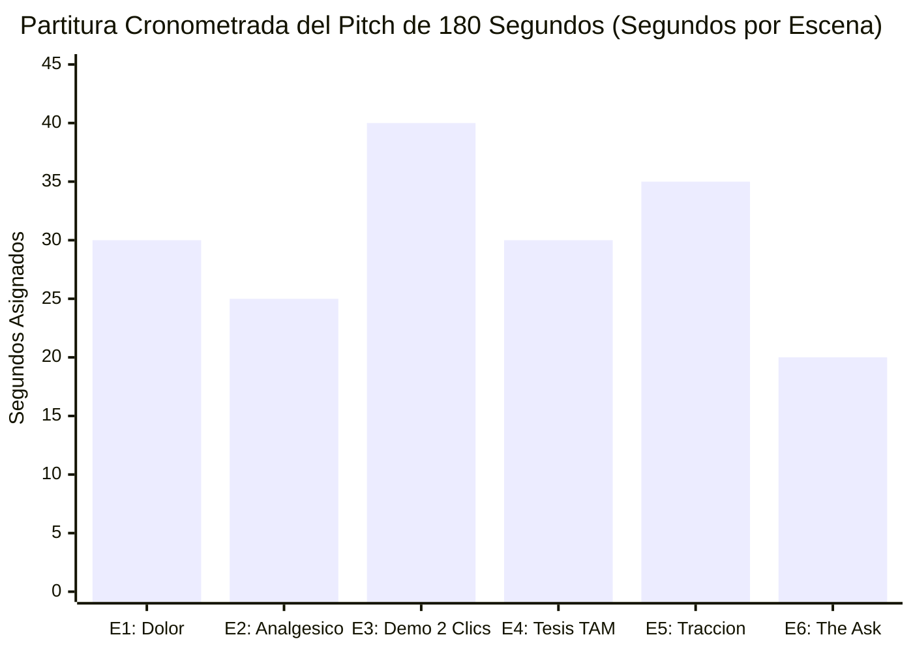
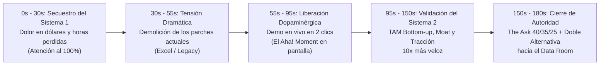
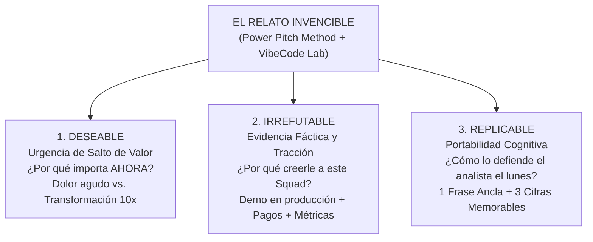
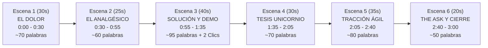
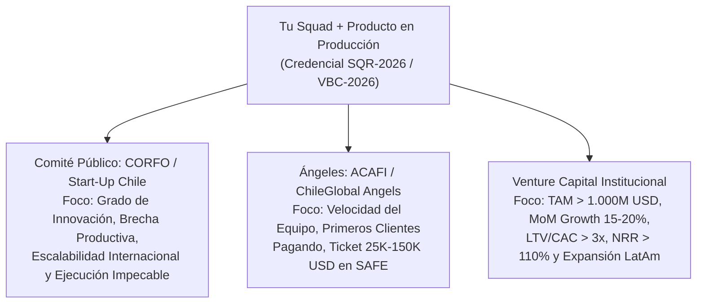

# TOMO II: EL PITCH IRREFUTABLE
### *Dramaturgia Escénica y Cierre de Capital en 180 Segundos*
**Subtítulo:** *El Power Pitch Method® aplicado a Startups de IA para hipnotizar comités de CORFO, Ángeles y Venture Capitals.*

> **Nota de Atribución y Reconocimiento Metodológico:** Este volumen adapta al ecosistema de startups de Inteligencia Artificial y *Vibe Coding* los principios dramáticos y comunicacionales del **Power Pitch Method®**, metodología original creada por **Héctor Sepúlveda Velásquez** (*El Mago del Desierto*). Su aplicación aquí se realiza con fines educativos y estratégicos dentro de la metodología de **VibeCode Lab**, integrando la ingeniería de software en vivo con la estructura de relatos deseables, irrefutables y replicables.

---

## PRÓLOGO: EL MANIFIESTO DE LA BIBLIA ÁGIL EN EL ESCENARIO

> **EL MANIFIESTO DE LA BIBLIA ÁGIL:**
> "El viejo Venture Capital murió. Durante veinte años te mintieron diciendo que para levantar capital necesitabas pasar seis meses diseñando un PowerPoint, quemar miles de dólares en agencias lentas y rogar por reuniones tomando café con inversionistas.
>
> Bienvenido a la era del **Vibe Coding y el Capital de Alta Velocidad**. Hoy, los equipos y *Squads* más ágiles del planeta no piden permiso ni levantan rondas con promesas vacías: despliegan arquitecturas serverless en producción en semanas, procesan pagos reales en vivo, automatizan su foso defensivo con agentes de IA y se sientan frente a CORFO, Ángeles y VCs con tracción irrefutable.
>
> Esta tetralogía no es un libro de lectura pasiva; es **La Biblia Operativa del Squad Moderno**. Es la metodología de levantamiento de capital para startups tecnológicas más ágil creada en la historia: un sistema diseñado para que equipos pequeños de alto rendimiento pasen de *localhost* a una valoración de Unicornio (\$1.000M+ USD) dominando el código, la dramaturgia escénica, los *unit economics* y la ingeniería financiera sin ceder el control de su compañía."

En el **Tomo I (Azul Eléctrico)** blindaste tu infraestructura para que tu producto compile y cobre en producción. Ahora enfrentas el segundo cuello de botella mortal de todo fundador técnico: **la incapacidad de comunicar el valor económico de su creación en menos de tres minutos**.

Los ingenieros y programadores suelen creer que los datos hablan por sí solos. Es una ilusión peligrosa. En un Demo Day o en una jornada de evaluación de CORFO o de un fondo Pre-Seed, los jueces escuchan entre quince y treinta presentaciones consecutivas. Al cuarto pitch, sus cerebros están saturados de frases idénticas: *"Somos una plataforma integral impulsada por IA que optimiza procesos mediante algoritmos avanzados"*. Cuando hablas en abstracto, el cerebro del inversor se desconecta.

Este **Tomo II (Vibe AI Purple)** transforma tu manera de pararte frente al capital. Vamos a sustituir la improvisación por una partitura dramática exacta de **180 segundos dividida en 6 escenas quirúrgicas**, con guiones literales palabra por palabra, tiempos cronometrados y matrices tácticas para cada tipo de comité.

---

## ANTES DE EMPEZAR: DICCIONARIO RÁPIDO DE SIGLAS DEL TOMO II
### *Para que hables el idioma del escenario, CORFO, Ángeles y Venture Capitals desde el minuto uno*

Antes de entrar en la neurociencia del jurado y en la guionización de tus 180 segundos, domina estas siglas fundamentales que aparecerán en cada escena:

| Sigla / Concepto | Nombre Completo | ¿Qué significa en 10 segundos en un Comité de Inversión? |
| :--- | :--- | :--- |
| **`TAM`** | *Total Addressable Market* | El tamaño total mundial del mercado si el $100\%$ de los clientes posibles compraran tu solución. |
| **`SAM`** | *Serviceable Available Market* | La porción real de ese mercado en tu geografía y segmento objetivo (ej. Chile, México y Colombia) que tu tecnología puede atender. |
| **`SOM`** | *Serviceable Obtainable Market* | La tajada concreta de facturación anual que tu *Squad* proyecta capturar en los próximos 24 a 36 meses. |
| **`Bottom-Up`** | *Cálculo de Abajo hacia Arriba* | La única forma seria de calcular mercado ante un VC: $\text{N° de Empresas Verificables} \times \text{Ticket Anual Promedio (ACV)}$. |
| **`ACV`** | *Annual Contract Value* | Cuánto dinero te paga en promedio un cliente a lo largo de un año completo de suscripción. |
| **`Moat`** | *Foso Defensivo* | La barrera estructural (datos propietarios, integraciones profundas o efectos de red) que impide que un competidor te copie en un fin de semana. |
| **`MRR`** | *Monthly Recurring Revenue* | Ingreso mensual recurrente por suscripciones activas. Es la prueba reina de tracción en la Escena 5. |
| **`LTV / CAC`** | *Lifetime Value sobre Costo de Adquisición* | Cuántas veces multiplicas el dinero que inviertes en conseguir un cliente (Meta institucional: $>3\times$). |
| **`Payback`** | *CAC Payback Period* | Cuántos meses tardas en recuperar lo que costó adquirir a un cliente nuevo (Meta saludable: $<6\text{ meses}$). |
| **`GTM`** | *Go-To-Market* | Tu motor comercial para adquirir clientes de forma repetible y escalable (el $40\%$ del uso de fondos en la Escena 6). |
| **`Runway`** | *Pista de Aterrizaje de Caja* | Cuántos meses de oxígeno financiero tiene tu empresa en el banco antes de quedarse sin efectivo (Meta por ronda: 14 a 18 meses). |
| **`The Ask`** | *La Solicitud de Inversión* | El monto exacto de capital que estás levantando en la ronda, cómo lo invertirás (`40/35/25`) y qué hito de ingresos desbloqueará. |
| **`Data Room`** | *Cuarto de Datos de Due Diligence* | Carpeta segura donde guardas tus métricas en vivo, finanzas, arquitectura y documentos legales para los inversores que pasan a segunda reunión. |
| **`CORFO`** | *Corporación de Fomento de la Producción* | Agencia chilena que entrega capital *Equity-Free* (**$0\%$ dilución**: Semilla Inicia, Semilla Expande y Start-Up Chile). |
| **`SAFE`** | *Simple Agreement for Future Equity* | Contrato ágil de 5 páginas creado por Y Combinator para cerrar inversión con Ángeles y aceleradoras en días sin trámites eternos. |

---

## CAPÍTULO 1: Neurociencia y Psicología del Comité de Inversión
### *Por qué los inversionistas toman decisiones emocionales y heurísticas en los primeros 30 segundos y las justifican con lógica financiera después*

### 1.1 El Gancho: El Juicio Silencioso Antes de tu Segunda Diapositiva
Observa la mesa del jurado en cualquier comité de inversión de Santiago, Bogotá o Ciudad de México. Tienes frente a ti a cuatro personas con teléfonos vibrando, hojas de cálculo abiertas y fatiga acumulada. Subes al escenario, tomas el micrófono y dices: *"Hola, buenos días, mi nombre es Andrés, vengo en representación del equipo X y hoy les voy a contar un poco sobre quiénes somos, nuestra misión y cómo nació nuestra aplicación..."*.

Acabas de desperdiciar los **22 segundos más caros de tu vida empresarial**. Mientras recitabas esa introducción protocolar vacía, el cerebro de cada miembro del comité ya ejecutó un filtro evolutivo implícito: *"¿Esto representa una amenaza urgente o una oportunidad extraordinaria a la que debo prestar energía cognitiva, o puedo revisar mi correo mientras este fundador termina de hablar?"*. Para cuando llegas a tu lámina financiera en el minuto dos, la decisión emocional ya fue tomada; el resto del tiempo el evaluador simplemente busca argumentos lógicos para confirmar su primera impresión.

### 1.2 La Tesis del Capítulo
Apoyándonos en la arquitectura cognitiva documentada por las ciencias del comportamiento (Sistema 1 rápido, asociativo y emocional vs. Sistema 2 lento, analítico y deliberativo), **ningún comité de inversión activa el esfuerzo analítico de revisar tus *unit economics* (Sistema 2) si primero no secuestras su atención límbica en los primeros 30 segundos (Sistema 1)** mediante un contraste dramático de dolor cuantificado y urgencia económica.

### 1.3 La Curva de Atención de un Comité en 180 Segundos

### 1.4 Comparativa Psicológica: El Pitch Informativo Tradicional vs. Dramaturgia Escénica de Alto Impacto

| Dimensión Cognitiva | Pitch Informativo Tradicional (El 95% que es olvidado) | Dramaturgia Power Pitch + VibeCode Lab (El 5% que cierra reuniones) |
|---|---|---|
| **Primeros 15 segundos** | Saludo protocolar, nombre de la empresa, foto del equipo o historia cronológica del fundador | Golpe directo con una cifra de pérdida económica verificable (*Hair-on-fire problem*) |
| **Lenguaje utilizado** | Abstracto y lleno de jerga (*"ecosistema sinérgico omnicanal con IA generativa"*) | Visual, concreto y sensorial (*"14 horas semanales copiando facturas PDF a un Excel que se rompe el viernes a las 20:00"*) |
| **Presentación del Producto** | Lista de 12 funcionalidades y capturas de pantalla estáticas llenas de botones | **2 clics en vivo** mostrando el contraste radical entre el Antes (caos lento) y el Después (resolución automática en 3 segundos) |
| **Postura frente al Inversor** | Subordinada (*"Esperamos que nos puedan apoyar con este financiamiento para sobrevivir"*) | De par a par (*"Abrimos una ventana de inversión para multiplicar esta tracción; ¿revisamos el Data Room el martes o el jueves?"*) |

### 1.5 Caso Práctico LatAm: Cómo Cambiar los Primeros 30 Segundos Multiplicó la Conversión a Reuniones de un SaaS Logístico en Chile (*Caso Ilustrativo*)
Un *Squad* de logística de última milla en Santiago abría su presentación diciendo: *"Somos RutaSmart, una plataforma SaaS en la nube que usa inteligencia artificial para optimizar rutas de despacho en pymes"*. En tres rondas de *speed dating* con ángeles, solo consiguieron una reunión de seguimiento.
Reescribieron sus primeros 30 segundos aplicando esta psicología:
*"En Chile, una distribuidora mediana pierde \$4.200 USD cada mes en petróleo quemado y entregas fallidas porque su jefe de bodega todavía arma las rutas de veinte camiones a mano en una planilla Excel a las seis de la mañana. Si ese jefe de bodega se enferma un lunes, la flota entera sale dos horas tarde."*
El producto técnico no había cambiado una sola línea de código, pero al cuantificar la hemorragia económica y dibujar la escena exacta del dolor, consiguieron **siete reuniones de *Data Room* de ocho posibles** en su siguiente presentación.

### 1.6 Errores Comunes que Apagan el Cerebro del Jurado
1. **Abrir pidiendo disculpas o mostrando nerviosismo:** Frases como *"Perdón si hablo muy rápido"* o *"No sé si se alcanza a ver bien en la pantalla"* destruyen tu estatus de autoridad en el segundo 3.
2. **Explicar cómo funciona el modelo de lenguaje por dentro en vez del resultado económico:** Al comité de inversión no le importa que uses *embeddings* vectoriales de 1.536 dimensiones; le importa que reduces el tiempo de auditoría de un contrato de 4 horas a 18 segundos con un 99,2% de precisión.
3. **Saturar las diapositivas con párrafos de texto:** El cerebro humano no puede leer un párrafo de 60 palabras en la pantalla y escuchar tu voz al mismo tiempo (efecto de interferencia del canal verbal). Si el juez lee tu lámina, deja de escucharte a ti.

### 1.7 Checklist Accionable del Capítulo 1
- [ ] Eliminar de tu guion cualquier saludo protocolar que dure más de 3 segundos.
- [ ] Asegurar que la primera frase de tu pitch contenga un sujeto concreto, una pérdida cuantificada en horas o dólares y una causa identificable.
- [ ] Auditar tus diapositivas bajo la regla de **máximo 12 palabras y 1 cifra protagonista por lámina**.
- [ ] Reemplazar todos los adjetivos vacíos (*"innovador"*, *"disruptivo"*, *"robusto"*) por sustantivos y números verificables.

### 1.8 Resumen Ejecutivo en 5 Bullets
* Los comités de inversión operan bajo fatiga cognitiva: el Sistema 1 decide en los primeros 30 segundos si mereces atención y el Sistema 2 justifica la decisión con números después.
* Nunca empieces hablando de ti ni de tu empresa; empieza hablando de la herida abierta y costosa del mercado (*Hair-on-fire problem*).
* La especificidad genera credibilidad inmediata: un número exacto y una escena cotidiana valen más que diez adjetivos grandilocuentes.
* Tus diapositivas son escenografía visual de apoyo; el protagonista escénico eres tú y tu producto funcionando en vivo.
* La autoridad en el escenario nace de saber que tu negocio avanza con o sin el cheque de esa sala; tú no pides ayuda, ofreces participación en un activo en crecimiento.

---

## CAPÍTULO 2: La Tríada del Relato Invencible
### *Cómo construir un discurso simultáneamente Deseable, Irrefutable y Replicable*

### 2.1 El Gancho: El Socio que No Estuvo en tu Presentación
He aquí un secreto sobre cómo funcionan los fondos de *Venture Capital* y los comités de CORFO que casi ningún fundador primerizo comprende: **la persona que te escucha en la primera reunión o en el Demo Day casi nunca tiene el poder unilateral de firmar el cheque sola**.

Ese analista, ejecutivo o socio junior tendrá que sentarse el lunes siguiente en el comité general de inversiones frente a tres socios senior que **no estuvieron en la sala cuando hiciste tu pitch** y tendrá solo dos minutos para defender por qué deberían invertir en tu *Squad* y no en las otras cuarenta startups de la semana. Si tu relato fue emocionante pero confuso, o si dependía exclusivamente de tu carisma personal pero no le dejaste al analista tres balas de plata fáciles de repetir de memoria, tu startup morirá el lunes por la mañana en una sala cerrada a la que ni siquiera fuiste invitado.

### 2.2 La Tesis del Capítulo
Siguiendo el núcleo estratégico del **Power Pitch Method®** adaptado a startups tecnológicas de alta velocidad, un pitch solo triunfa cuando cumple simultáneamente tres propiedades estructurales: es **Deseable** (genera urgencia por el salto de valor), **Irrefutable** (está anclado en datos fácticos, arquitectura en producción y tracción real) y **Replicable** (está condensado en una estructura tan nítida que cualquier evaluador puede defenderlo sin ti frente a su comité).

### 2.3 La Arquitectura de la Tríada Invencible

### 2.4 Matriz de Diagnóstico de la Tríada (¿Qué pasa cuando falta uno de los 3 pilares?)

| Combinación en tu Pitch | Diagnóstico del Comité | Resultado Típico | Cómo Corregirlo Hoy |
|---|---|---|---|
| **Deseable + Replicable, pero NO Irrefutable** | *"Suena como un sueño increíble y fácil de entender, pero es puro humo; no tienen producto en vivo ni evidencia de que alguien pague"* | Rechazo por falta de tracción (*"Vuelvan cuando tengan métricas"*) | Insertar la Demo en 2 clics en producción (Tomo I) y los resultados del experimento de pauta real |
| **Irrefutable + Replicable, pero NO Deseable** | *"El software funciona perfecto y los números cuadran, pero resuelven un problema tibio que a nadie le urge comprar"* | Rechazo por mercado pequeño o falta de urgencia (*"Nice-to-have, no Must-have"*) | Reencuadrar la Escena 1 cuantificando el costo de inacción en dólares y riesgo operativo |
| **Deseable + Irrefutable, pero NO Replicable** | *"Me encantó cuando los vi en el escenario, pero ahora en el comité de socios no logro explicar exactamente qué hacen ni cómo ganan plata"* | El campeón interno pierde el debate frente a socios escépticos | Crear una **Frase Ancla de 15 palabras** que una el dolor, el mecanismo de IA y la métrica de negocio |
| **DESEABLE + IRREFUTABLE + REPLICABLE** | *"Resuelven un dolor de \$500M USD, el producto ya está cobrando en producción con LTV/CAC de 4.5x y cualquiera en esta mesa entiende el modelo en 10 segundos"* | **Acceso inmediato al Data Room y Term Sheet** | Estándar obligatorio de **La Biblia del Squad Ágil** |

### 2.5 Cómo Construir tu "Frase Ancla Replicable" (La Fórmula de las 18 Palabras)
Para garantizar la **Replicabilidad**, antes de cerrar la Escena 5 de tu pitch debes entregarle al comité una frase sintética que ellos puedan anotar textualmente en su libreta. Usa esta plantilla estructural:

> **Plantilla de Frase Ancla Replicable:**
> *"En resumen: **[Nombre del SaaS]** automatiza **[proceso doloroso específico]** para **[cliente B2B exacto]**, reduciendo **[métrica de dolor en tiempo/dinero]** a **[nuevo estándar en segundos/costo]** mediante un modelo SaaS recurrente que ya crece al **[X]%** mensual."*

**Ejemplo Real Aplicado:**
> *"En resumen: **LexiaFlow** automatiza la revisión de carpetas tributarias para estudios contables en Chile y México, reduciendo 6 horas de auditoría manual a 45 segundos con agentes de IA en producción y un ticket recurrente de \$120 USD/mes."*

### 2.6 Caso Práctico LatAm: El Analista de VC en Ciudad de México que Defendió la Ronda con Tres Cifras (*Caso Ilustrativo*)
Una startup colombiana de cobranza preventiva B2B para distribuidoras de consumo masivo entrenó su pitch bajo la Tríada. En lugar de dar veinte estadísticas dispersas, diseñaron su relato alrededor de **tres números imposibles de olvidar ("La Regla del 3-90-4")**:
1. **3%** es el margen neto que pierden las distribuidoras por facturas vencidas a más de 60 días.
2. **90 segundos** tarda nuestro agente de WhatsApp conectado al ERP en conciliar y reprogramar el pago con el tendero.
3. **4,2x** es nuestro ratio LTV/CAC actual con 42 distribuidoras pagando en vivo.
Cuando la asociada del fondo defendió el caso el lunes en el comité de inversión en Ciudad de México, ni siquiera necesitó proyectar el *deck*: repitió de memoria la regla del **3-90-4** y consiguió la aprobación unánime para pasar a *Due Diligence* legal.

### 2.7 Errores Comunes en la Construcción de la Tríada
1. **Usar analogías confusas ("Somos el Uber de los recursos humanos mezclado con Notion y ChatGPT"):** Si necesitas tres empresas distintas para explicar qué haces, el analista no podrá replicarlo sin sonar ridículo.
2. **Declarar que tu propuesta es "Irrefutable" usando encuestas de intención en vez de comportamiento pagado:** Decir *"Encuestamos a 100 personas y el 92% dijo que pagaría"* tiene valor probatorio cero. Decir *"Invertimos \$20 USD en pauta durante 48 horas hacia nuestra landing con botón de pago y 14 empresas dejaron su tarjeta con un CAC de \$1,42 USD"* es irrefutable.
3. **Esconder el modelo de negocio hasta la última pregunta del jurado:** La deseabilidad para un inversor incluye saber cómo captura valor económico tu compañía.

### 2.8 Checklist Accionable del Capítulo 2
- [ ] Someter tu guion actual al test de los 3 pilares: subrayar en azul las frases de **Deseabilidad**, en verde las pruebas de **Irrefutabilidad** y en amarillo la **Frase Ancla Replicable**.
- [ ] Redactar tu **Frase Ancla Replicable** en menos de 25 palabras y probarla con alguien ajeno a tu industria: si después de escucharla una vez puede repetírsela a un tercero sin perder el sentido, está lista.
- [ ] Seleccionar las **3 Cifras Ancla** de tu presentación (1 de Dolor, 1 de Velocidad/Demo y 1 de Tracción/Unit Economics).

### 2.9 Resumen Ejecutivo en 5 Bullets
* Nunca le hablas solo a las personas presentes en la sala; hablas a través de ellas hacia el comité de socios que decidirá sin ti el lunes siguiente.
* Un discurso **Deseable** despierta el hambre por el tamaño de la oportunidad y la urgencia del dolor.
* Un discurso **Irrefutable** reemplaza adjetivos y promesas por demostraciones en producción y experimentos reales de adquisición pagada.
* Un discurso **Replicable** equipa a tu campeón interno con una frase ancla y tres cifras memorables fáciles de defender en 30 segundos.
* Si falta cualquiera de los tres vértices de la Tríada, la fricción del proceso de inversión detendrá el cierre de tu ronda.

---

## CAPÍTULO 3: Guionización Quirúrgica de las 6 Escenas (180 Segundos)
### *Partitura cronometrada segundo a segundo con guiones literales para Startups de IA*

### 3.1 El Gancho: 180 Segundos a 140 Palabras por Minuto = 420 Palabras Exactas
Tres minutos parecen mucho tiempo cuando estás sentado en tu escritorio, pero arriba del escenario pasan como un relámpago. A una cadencia escénica profesional, clara y con pausas estratégicas (**135 a 145 palabras por minuto**), un pitch de 180 segundos contiene exactamente entre **400 y 435 palabras**.

Cada palabra que agregas por encima de ese límite te obliga a hablar atropelladamente, comer las sílabas finales o, peor aún, sufrir la humillación de que la campana del jurado te corte el micrófono en la Escena 5 antes de haber pronunciado tu *Ask* y tu cierre. Por eso, en **VibeCode Lab** no escribimos "pitches aproximados"; guionizamos las **6 Escenas** con precisión quirúrgica de relojero suizo.

### 3.2 Mapa Maestro de las 6 Escenas (180 Segundos Totales)

| Escena | Ventana de Tiempo | Duración | Palabras Objetivo | Objetivo Psicológico y Financiero |
|---|---|---|---|---|
| **1. El Dolor** | `00:00 – 00:30` | **30 s** | ~70 palabras | Cuantificar el *Hair-on-fire problem* en horas y dólares perdidos vs. brecha de productividad regional |
| **2. El Analgésico** | `00:30 – 00:55` | **25 s** | ~60 palabras | Demoler con elegancia los *workarounds* actuales (Excel, procesos manuales y software *legacy* desconectado) |
| **3. La Solución & Demo en 2 Clics** | `00:55 – 01:35` | **40 s** | ~95 palabras | Mostrar en producción el contraste del *Antes vs. Después* impulsado por agentes de IA |
| **4. La Ambición y Tesis de Unicornio** | `01:35 – 02:05` | **30 s** | ~70 palabras | Presentar el TAM/SAM/SOM *Bottom-up* y el *Moat* (datos propietarios e infraestructura sin costo marginal) |
| **5. Tracción e Implementación Ágil** | `02:05 – 02:40` | **35 s** | ~80 palabras | Demostrar con métricas de sangre y pauta real que tu *Squad* ejecuta 10 veces más rápido que la industria |
| **6. The Ask, Uso de Fondos y Cierre** | `02:40 – 03:00` | **20 s** | ~50 palabras | Fórmula **40% GTM / 35% I+D IA / 25% Runway**, Hito Desbloqueador y **Cierre de Doble Alternativa** al Data Room |

---

### 3.3 Desglose Quirúrgico y Guiones Literales de las 6 Escenas

A continuación encontrarás la estructura, la anatomía técnica y el **guion literal palabra por palabra** para cada una de las 6 escenas (utilizando como hilo conductor un SaaS B2B real de automatización de licitaciones y cumplimiento operativo con IA en Latinoamérica, fácilmente adaptable a tu vertical).

---

#### ESCENA 1: EL DOLOR (Duración: 30 Segundos · `00:00 – 00:30`)
* **Misión Escénica:** Anclar un problema urgente (*Hair-on-fire problem*) cuantificado en horas de trabajo calificado y dólares perdidos por empresa, conectándolo con la brecha estructural de productividad de la región.
* **Fórmula Matemática del Dolor:**
  $$\text{Costo Anual del Dolor por Cliente} = (\text{Horas Perdidas/Semana} \times 52 \times \text{Costo Hora}) + (\text{Ingresos Perdidos por Errores/Retrasos})$$
* **Guion Literal Palabra por Palabra (72 palabras — 30 segundos):**
  > *"En Latinoamérica, el 68% de las empresas proveedoras de ingeniería y servicios B2B pierde contratos millonarios no por falta de capacidad técnica, sino por llegar tarde o con errores de forma a las licitaciones. Hoy, un gerente de operaciones gasta **18 horas semanales** leyendo bases técnicas de 300 páginas en PDF, perdiendo en promedio **\$48.000 dólares al año** en horas de ingeniería improductiva y adjudicaciones rechazadas por un documento vencido."*
* **Dirección Escénica:** Voz firme, sin saludo previo. En pantalla solo aparece el número **`$48.000 USD / año perdidos por empresa`** sobre fondo oscuro `#040814`.

---

#### ESCENA 2: EL ANALGÉSICO (Duración: 25 Segundos · `00:30 – 00:55`)
* **Misión Escénica:** Demoler con elegancia por qué las soluciones actuales (*workarounds* como planillas Excel compartidas, carpetas de Google Drive o ERPs *legacy* de los años 90) son parches analgésicos que agravan la enfermedad en lugar de curarla.
* **Guion Literal Palabra por Palabra (61 palabras — 25 segundos):**
  > *"¿Y cómo intentan resolverlo hoy? Con parches rotos: planillas de Excel con veinte pestañas desactualizadas, hilos infinitos de WhatsApp buscando certificados y softwares legacy que solo almacenan archivos mudos sin leer una sola línea. Esos analgésicos obligan a contratar más analistas administrativos para copiar y pegar datos manualmente, destruyendo el margen operativo cada vez que la empresa intenta escalar."*
* **Dirección Escénica:** Da medio paso adelante al mencionar *"planillas de Excel con veinte pestañas"*. Haz una pausa de 1 segundo completo después de *"escalar"*.

---

#### ESCENA 3: LA SOLUCIÓN & DEMO EN 2 CLICS (Duración: 40 Segundos · `00:55 – 01:35`)
* **Misión Escénica:** Presentar tu producto como la cura definitiva y ejecutar en vivo, frente a los ojos del jurado, **la demostración de 2 clics en producción** narrando el contraste entre el *Antes* (18 horas de caos) y el *Después* (resolución autónoma por agentes de IA en segundos).
* **Guion Literal Palabra por Palabra (96 palabras — 40 segundos):**
  > *"Por eso creamos **LicitAI**, el primer motor de agentes autónomos que audita, cruza y arma propuestas técnicas B2B en segundos. Miren nuestra plataforma operando ahora mismo en producción:
  > **[CLIC 1]** Subimos este pliego real de 240 páginas de una licitación minera en Chile. Nuestro enjambre de agentes extrae cada requisito legal, técnico y financiero en paralelo.
  > **[CLIC 2]** Y en **4 segundos**, el sistema cruza los requisitos contra la bóveda documental de la empresa, redacta los anexos técnicos y alerta el único certificado que vence mañana. Lo que antes tomaba tres días hoy ocurre en dos clics."*
* **Dirección Escénica:** Señala la pantalla exactamente en el `[CLIC 1]` y `[CLIC 2]`. Recuerda tener activado tu protocolo de *Cache Warming* y tu *Backup de Video Local a 60fps* del Tomo I.

---

#### ESCENA 4: LA AMBICIÓN Y TESIS DE UNICORNIO (Duración: 30 Segundos · `01:35 – 02:05`)
* **Misión Escénica:** Demostrar que esto no es una herramienta de nicho local, sino una tesis de categoría regional calculada de abajo hacia arriba (*Bottom-up TAM/SAM/SOM*) con un foso defensivo (*Moat*) que se vuelve más profundo con cada documento procesado.
* **Fórmula de Cálculo *Bottom-Up* (Prohibido el *Top-Down* flojo):**
  $$\text{SAM Anual} = \text{N° de Empresas Target Verificables en la Región} \times \text{ACV (Ticket Anual Promedio)}$$
* **Guion Literal Palabra por Palabra (71 palabras — 30 segundos):**
  > *"No estamos construyendo una herramienta local; estamos capturando la infraestructura de contratación B2B de América Latina. Solo entre Chile, México y Colombia existen **420.000 empresas proveedoras del Estado y gran industria**. Con nuestro ticket anual de **\$2.400 dólares**, atacamos un mercado direccionable directo de **\$1.008 millones de dólares**. Nuestro foso defensivo es propietario: cada licitación adjudicada entrena nuestra matriz sectorial de precios y cumplimiento con costo marginal cercano a cero."*

---

#### ESCENA 5: TRACCIÓN E IMPLEMENTACIÓN ÁGIL (Duración: 35 Segundos · `02:05 – 02:40`)
* **Misión Escénica:** Demostrar con evidencia fáctica que tu *Squad* opera bajo la metodología de **Vibe Coding y Capital de Alta Velocidad**, ejecutando 10 veces más rápido que una startup tradicional y validando adquisición pagada en el mercado real.
* **Guion Literal Palabra por Palabra (82 palabras — 35 segundos):**
  > *"Y no vinimos con un PowerPoint; vinimos con tracción auditada en producción. Nuestro Squad desplegó la arquitectura completa en Vercel, Supabase y Cloudflare R2 en tres semanas con un **88% de margen bruto**. Encendimos validación real en el mercado: en los últimos 45 días alcanzamos **\$6.400 dólares de MRR** con 28 empresas pagando suscripción activa vía Mercado Pago Live, un **Payback de 2,4 meses** y un ratio **LTV sobre CAC de 5,1 veces**. Ejecutamos en días lo que a la industria le toma semestres."*

---

#### ESCENA 6: THE ASK, USO DE FONDOS Y CIERRE DE DOBLE ALTERNATIVA (Duración: 20 Segundos · `02:40 – 03:00`)
* **Misión Escénica:** Declarar el monto exacto de la ronda, su distribución táctica bajo la **Fórmula 40/35/25**, el **Hito Desbloqueador** que multiplicará la valoración hacia la siguiente ronda, y ejecutar el **Cierre Psicológico de Doble Alternativa** para agendar el acceso al *Data Room*.
* **La Fórmula de Asignación de Capital 40 / 35 / 25:**
  - **40% Go-To-Market (GTM) & Adquisición Escalable:** Pauta de rendimiento verificada, motor PLG y cierre comercial B2B.
  - **35% I+D en Agentes de IA & Foso de Datos:** Automatización profunda, evaluación de modelos y reducción de latencia/costo de inferencia.
  - **25% Runway Operativo & Resiliencia de Caja:** Garantizar 18 meses de pista para negociar la siguiente ronda desde una posición de fuerza.
* **Guion Literal Palabra por Palabra (52 palabras — 20 segundos):**
  > *"Hoy abrimos una ronda Pre-Seed de **\$150.000 dólares** —destinando **40% a Go-To-Market, 35% a I+D de agentes de IA y 25% a 18 meses de runway**— para escalar de \$6.400 a **\$45.000 dólares de MRR** en 12 meses. Nuestro Data Room y certificado **SQR-2026** están listos: **¿los revisamos mañana miércoles a las 10:00 AM o prefieren el jueves a las 15:00 horas?** Muchas gracias."*

---

### 3.4 Errores Comunes en la Ejecución de las 6 Escenas
1. **Invertir el orden y empezar por la solución (Escena 3) antes de haber creado el dolor (Escena 1):** Si muestras un martillo antes de que el comité sienta el dolor del clavo suelto, tu producto parecerá una curiosidad técnica prescindible.
2. **Calcular el TAM de arriba hacia abajo (*"El mercado global del software es de 5 billones de dólares y si capturamos el 0,1%..."*):** Ningún inversionista profesional respeta el cálculo *Top-Down*. Calcula siempre *Bottom-Up*: $\text{Número de clientes identificables} \times \text{Ticket anual real}$.
3. **Cerrar diciendo *"¿Tienen alguna pregunta?"* o *"Muchas gracias por su tiempo"* sin llamado a la acción:** El final de tu pitch es el momento de mayor autoridad escénica; ciérralo siempre con una **Doble Alternativa** que conduzca al *Data Room*.

### 3.5 Checklist Accionable del Capítulo 3
- [ ] Escribir tu guion completo de las 6 escenas y verificar con un contador de palabras que tenga entre **400 y 435 palabras totales**.
- [ ] Cronometrar en voz alta cada una de las 6 escenas con un reloj visible: 30s / 25s / 40s / 30s / 35s / 20s.
- [ ] Verificar que la Escena 4 utilice cálculo *Bottom-Up* ($\text{Clientes} \times \text{Ticket Anual}$).
- [ ] Verificar que la Escena 6 incluya la distribución **40% GTM / 35% I+D IA / 25% Runway**, el **Hito Desbloqueador de MRR** y la pregunta de **Cierre de Doble Alternativa**.

### 3.6 Resumen Ejecutivo en 5 Bullets
* Un pitch de 180 segundos no es un resumen improvisado; es una obra de ingeniería dramática de ~420 palabras distribuida en 6 escenas exactas.
* Las Escenas 1 y 2 (55 segundos) abren la herida económica y demuelen los parches actuales para crear hambre por tu solución.
* La Escena 3 (40 segundos) demuestra tu producto en producción en máximo 2 clics, eliminando el riesgo de ejecución técnica.
* Las Escenas 4 y 5 (65 segundos) satisfacen al Sistema 2 del comité con un mercado *Bottom-up* de escala Unicornio y métricas de tracción reales.
* La Escena 6 (20 segundos) encuadra el capital bajo la regla 40/35/25 como un acelerador hacia el siguiente hito de valoración y cierra agendando el *Data Room*.

---

## CAPÍTULO 4: Camaleón Estratégico: CORFO, Ángeles y Venture Capitals
### *Matrices de adaptación del discurso según el interlocutor: qué evalúa un ejecutivo público, qué mueve a un Ángel y qué exige un Partner de VC*

### 4.1 El Gancho: El Mismo Pitch que Gana un Venture Capital Puede Hacerte Reprobar en CORFO (y Viceversa)
Un error clásico de los fundadores en Chile y Latinoamérica es recitar exactamente el mismo énfasis argumental frente a tres audiencias cuyas funciones de incentivos son radicalmente distintas.

Si te sientas frente a un comité evaluador de **CORFO (Semilla Inicia o Semilla Expande)** y dedicas la mitad de tu tiempo a hablar de cómo tu empresa será adquirida en Delaware por un fondo estadounidense en cinco años sin mencionar el impacto productivo nacional, la escalabilidad desde Chile o la coherencia técnica del presupuesto cofinanciado, perderás puntos críticos en la rúbrica pública. Por el contrario, si te sientas frente a un **Partner de Venture Capital institucional (como Kaszek, Canary, Magma o Platanus)** y le hablas de un crecimiento conservador del 20% anual enfocado únicamente en una provincia, te descartará en el acto porque la matemática de su fondo exige que cada inversión tenga el potencial de devolver el fondo entero (*Fund Returner*).

### 4.2 La Tesis del Capítulo
La estructura de las **6 Escenas (180 segundos)** permanece constante, pero el **Camaleón Estratégico** ajusta la calibración de las Escenas 1, 4, 5 y 6 según la matriz de incentivos de su interlocutor: **Impacto Productivo, Innovación y Ejecución Presupuestaria para CORFO**; **Skin-in-the-Game, Velocidad del Squad y Cercanía al Mercado para Inversionistas Ángeles**; y **Escala Continental, Defensibilidad (*Moat*) y Unit Economics de Hipercrecimiento para Venture Capitals**.

### 4.3 Flujo de Decisión y Enfoque según el Tipo de Comité

### 4.4 Matriz Maestra de Adaptación del Discurso por Interlocutor

| Dimensión del Pitch | Evaluador CORFO (Semilla Inicia / Expande) | Ángel Inversionista (ACAFI / ChileGlobal Angels / Sindicatos) | Partner de VC Institucional (Pre-Seed / Seed / Serie A) |
|---|---|---|---|
| **Qué busca su mandato** | Cofinanciar emprendimientos dinámicos con diferenciación tecnológica real que cierren brechas productivas y escalen ventas | Apostar su propio patrimonio en equipos ultra-ágiles con tracción temprana que multipliquen su valoración en 12–18 meses | Encontrar *outliers* capaces de dominar una categoría en toda Latinoamérica y alcanzar una valoración de \$100M–\$1.000M+ USD |
| **Ajuste en Escena 1 (El Dolor)** | Conectar el dolor de la empresa con una brecha de productividad sectorial o nacional respaldada por cifras oficiales | Destacar el dolor agudo que el propio Ángel conoce por su experiencia ejecutiva en la industria | Demostrar que el dolor es estructural, frecuente, urgente y transversal en múltiples países (Chile, México, Colombia, Brasil) |
| **Ajuste en Escena 3 (La Demo)** | Enfatizar el **grado de innovación técnica** (por qué tu arquitectura de agentes de IA supera el estado del arte tradicional) | Enfatizar la **velocidad de adopción y simplicidad** (por qué el cliente saca la tarjeta en la primera sesión) | Enfatizar la **automatización sin intervención humana** (escalabilidad con margen bruto >80% y efecto de red de datos) |
| **Ajuste en Escena 5 (Tracción)** | Mostrar validación comercial real, pilotos pagados o primeras facturas electrónicas emitidas y velocidad de ejecución del *Squad* | Mostrar cuánto lograron construir y vender con recursos mínimos (*eficiencia de capital*) | Mostrar tasa de crecimiento compuesto mensual (*MoM Growth* 15%–20%), retención de cohortes y *Payback* < 6 meses |
| **Ajuste en Escena 6 (The Ask)** | Desglose normativo: Actividades obligatorias de validación comercial, empaquetamiento y equipo, más cofinanciamiento (*aporte pecuniario*) | Monto del ticket ángel (\$25K–\$150K USD) bajo instrumento **Post-Money SAFE** con *Valuation Cap* claro y rápido de firmar | Ronda completa (\$500K–\$2.5M USD), plan de apertura de segundo país (México/Colombia) e hito exacto hacia Serie A |
| **Principal Red Flag que los espanta** | Que el subsidio se use para "empezar a programar desde cero" sin validación o que el proyecto sea una consultoría tradicional disfrazada | Fundadores lentos, sin dedicación real, con *Cap Table* roto o peleas societarias tempranas | Mercados locales pequeños sin tesis regional, costos de adquisición (*CAC*) descontrolados o servicios manuales no escalables |

### 4.5 Caso Práctico LatAm: Cómo un Mismo Squad Ajustó su Escena 4 y 6 para Ganar CORFO Semilla Expande y Cerrar un SAFE Ángel en el Mismo Trimestre (*Caso Ilustrativo*)
Un *Squad* de agrotecnología e inteligencia hídrica en la zona central de Chile tenía su plataforma funcionando en producción con 18 predios agrícolas pagando suscripción mensual:
1. **En su pitch de 180 segundos para CORFO Semilla Expande:** En la Escena 1 anclaron el dolor en la pérdida hídrica del sector agroexportador chileno; en la Escena 3 destacaron la innovación de su modelo predictivo satelital; y en la Escena 6 estructuraron el uso del subsidio *equity-free* en **crecimiento comercial verificado y escalamiento nacional**, comprometiendo un aumento del 120% en ventas facturadas durante los 9 meses de ejecución. Adjudicaron el fondo sin ceder un 1% de su empresa.
2. **Dos semanas después, ante una red de Inversionistas Ángeles en Santiago:** Con el sello de validación y el capital *equity-free* ya adjudicado (lo que redujo el riesgo financiero para el inversor privado), ajustaron la Escena 4 hacia la expansión a los valles agroindustriales de Perú y México (mercado de \$1.200M USD) y en la Escena 6 abrieron un *Post-Money SAFE* por \$120.000 USD con un *Valuation Cap* de \$2.000.000 USD para financiar la apertura comercial en Lima. Cerraron el sindicato ángel en tres semanas.

### 4.6 Protocolo para Dominar la Ronda de Preguntas y Respuestas (*Q&A* de 3 a 5 Minutos)
Muchos fundadores hacen un pitch brillante de 180 segundos y luego destruyen su credibilidad en los 3 minutos de preguntas del jurado porque responden con discursos eternos de dos minutos por pregunta.

Aplica la **Regla del Disparo Francotirador en el Q&A (Máximo 25 segundos por respuesta):**
1. **Segundo 1 al 3 (Titular Directo):** Responde "Sí", "No" o el número exacto en la primera oración. (Ej.: *"Nuestro CAC pagado actual es de \$42 dólares y lo recuperamos en el primer mes."*).
2. **Segundo 4 al 18 (Evidencia de Respaldo):** Entrega el dato operativo que sostiene ese titular. (Ej.: *"Lo logramos combinando pauta segmentada en Meta Ads con un diagnóstico interactivo que convierte al 14% sin vendedores humanos."*).
3. **Segundo 19 al 25 (Puente de Valor y Silencio):** Conecta con el beneficio estratégico y **cállate**. Mientras más respuestas cortas y contundentes logres entregar en 3 minutos de Q&A, mayor será el puntaje de dominio que te asignará el comité.

### 4.7 Errores Comunes Frente a Comités Diversos
1. **Discutir a la defensiva con un juez durante el Q&A:** Si un miembro del comité hace una crítica dura o parte de un supuesto equivocado, jamás respondas con arrogancia. Usa el giro de aikido verbal: *"Excelente punto; de hecho, nosotros teníamos exactamente esa misma hipótesis al inicio, y cuando corrimos 40 pruebas en producción descubrimos que..."*.
2. **Inventar una cifra financiera en el escenario cuando no la sabes:** Si un Partner de VC te pregunta por el *Churn* de una cohorte específica que no tienes en mente, nunca inventes un número. Di con aplomo: *"No quiero darte una cifra inexacta de memoria en el escenario; tenemos el desglose por cohorte en PostHog dentro del Data Room y te lo comparto apenas bajemos"*.
3. **Presentarse a CORFO sin tener el prototipo desplegado y navegable:** En el ecosistema actual, llegar con una idea en papel cuando otros equipos llegan con un SaaS facturando en producción te deja automáticamente fuera del percentil de adjudicación.

### 4.8 Checklist Accionable del Capítulo 4
- [ ] Preparar **tres versiones de las diapositivas de las Escenas 1, 4 y 6**: versión `CORFO_EquityFree`, versión `Angel_SAFE` y versión `VC_Seed`.
- [ ] Construir un **Anexo de Q&A (*Appendix Slides*)** después de la lámina final de tu presentación con 6 láminas de respaldo listas para saltar en un clic: 1) Arquitectura Técnica (Tomo I), 2) Cohorte de Retención y Unit Economics (Tomo III), 3) Cap Table y Uso de Fondos detallado (Tomo IV), 4) Análisis Competitivo, 5) Roadmap de Agentes de IA y 6) Credencial de Verificación Pública `/verify/[id]`.
- [ ] Ensayar 15 preguntas difíciles con cronómetro aplicando la **Regla de los 25 Segundos por Respuesta**.

### 4.9 Resumen Ejecutivo en 5 Bullets
* El producto y la columna vertebral de las 6 escenas son únicos, pero el énfasis estratégico debe calibrarse según quién está sentado al otro lado de la mesa.
* **CORFO y fondos públicos** premian la innovación verificable, el cierre de brechas productivas, la coherencia presupuestaria y la tracción comercial auditable sin dilución.
* **Los Inversionistas Ángeles** invierten en la velocidad de ejecución del *Squad*, la claridad del dolor industrial y términos simples en un *Post-Money SAFE*.
* **Los fondos de Venture Capital** buscan escala continental (\$1.000M+ USD), fosos defensivos basados en datos y *unit economics* de clase mundial.
* En el Q&A se ganan o se pierden las rondas: responde cada pregunta en menos de 25 segundos con la estructura *Titular Directo -> Evidencia -> Silencio*.

---

## EPÍLOGO DEL TOMO II: YA TIENES EL ARTEFACTO Y LA DRAMATURGIA. AHORA BLINDEMOS TUS NÚMEROS

Has completado el **Tomo II (Púrpura Escenario)**. Ahora dominas la neurociencia de los primeros 30 segundos, la Tríada del Relato Invencible (**Deseable, Irrefutable y Replicable**), el guion literal de las **6 Escenas en 180 segundos** y la matriz del Camaleón Estratégico para CORFO, Ángeles y VCs.

Cuando termines tu Escena 6 y el socio del fondo acepte tu **Cierre de Doble Alternativa** (*"Revisemos el Data Room el jueves a las 10:00 AM"*), se abrirá la puerta de la verdad financiera. En esa reunión privada ya no habrá luces de escenario: abrirán tu planilla financiera y auditarán implacablemente tu **MRR, tu ratio LTV/CAC, tu *Payback Period*, tu Retención Neta de Ingresos (*NRR*) y tu Regla del 40%**.

En el **Tomo III (Esmeralda Métricas): *Métricas que Mueven la Aguja***, construirás el motor matemático que convierte a tu startup en una máquina financiera invulnerable al Valle de la Muerte.

---

## TU SIGUIENTE PASO: EXAMEN DE DOMINIO DEL TOMO II & CERTIFICADO `SQR-2026`

Pon a prueba tu dominio de la dramaturgia escénica de este tomo: escanea el **Código QR Dinámico del Tomo II** para entrar al **Examen Interactivo de Lectura de VibeCode Lab (`/ebook-quiz`)**, reforzar las 6 escenas del pitch y la matriz CORFO/Ángeles/VC, emitir tu certificado público **`SQR-2026-XXX`** y dar el paso para implementar junto a otros founders en la **Comunidad de VibeCode Lab**:

* **Ruta Corta Impresa:** [`https://www.javiermujica.com/go/2`](https://www.javiermujica.com/go/2)
* **Enlace Directo al Quiz del Tomo II:** [`https://www.javiermujica.com/ebook-quiz?vol=2&utm_campaign=unicorn_bible`](https://www.javiermujica.com/ebook-quiz?vol=2&utm_campaign=unicorn_bible)
