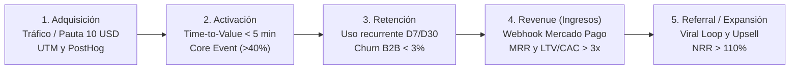
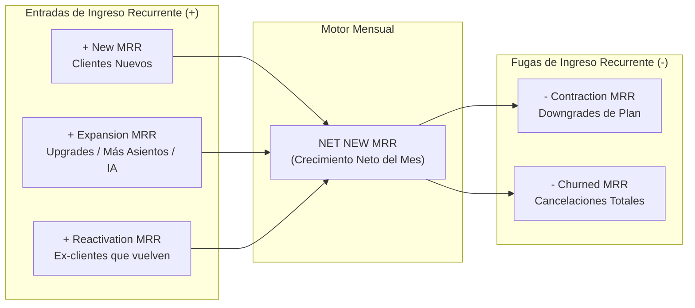
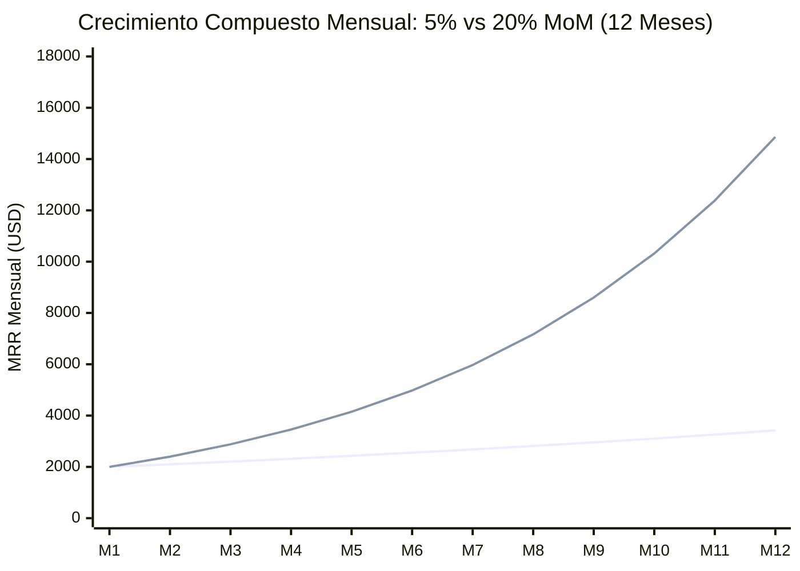
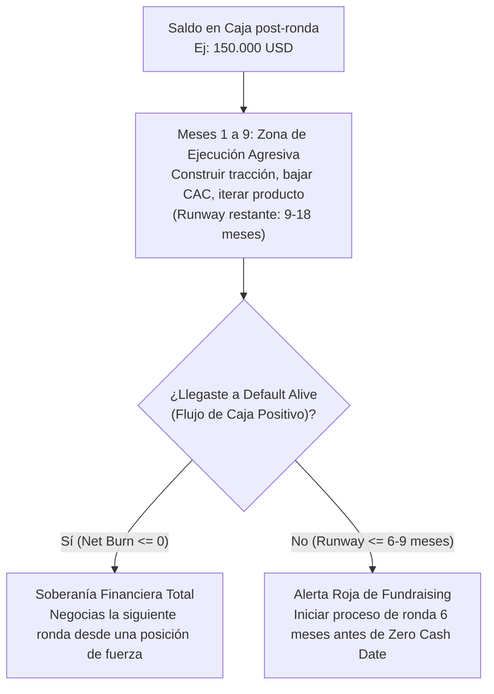

# TOMO III: MÉTRICAS QUE MUEVEN LA AGUJA
## Unit Economics y Tracción Financiera para SaaS
*El lenguaje matemático con el que los Venture Capitals valoran empresas de software e Inteligencia Artificial*

---

## PRÓLOGO DEL TOMO III: LA SANGRE CONTABLE DEL SQUAD

> **EL MANIFIESTO DE LA BIBLIA ÁGIL:**
> "El viejo Venture Capital murió. Durante veinte años te mintieron diciendo que para levantar capital necesitabas pasar seis meses diseñando un PowerPoint, quemar miles de dólares en agencias lentas y rogar por reuniones tomando café con inversionistas.
>
> Bienvenido a la era del **Vibe Coding y el Capital de Alta Velocidad**. Hoy, los equipos y *Squads* más ágiles del planeta no piden permiso ni levantan rondas con promesas vacías: despliegan arquitecturas serverless en producción en semanas, procesan pagos reales en vivo, automatizan su foso defensivo con agentes de IA y se sientan frente a CORFO, Ángeles y VCs con tracción irrefutable.
>
> Esta tetralogía no es un libro de lectura pasiva; es **La Biblia Operativa del Squad Moderno**. Es la metodología de levantamiento de capital para startups tecnológicas más ágil creada en la historia: un sistema diseñado para que equipos pequeños de alto rendimiento pasen de *localhost* a una valoración de Unicornio (\$1.000M+ USD) dominando el código, la dramaturgia escénica, los *unit economics* y la ingeniería financiera sin ceder el control de su compañía."

En el **Tomo I** construiste un búnker de ingeniería en producción (`Vercel` + `Supabase` con *Connection Pooling* + `Mercado Pago` con Webhooks idempotentes + `PostHog` + `Cloudflare R2`). En el **Tomo II** diseñaste una partitura escénica de 180 segundos capaz de dominar cualquier sala de evaluación con una demostración de producto en vivo y un guion cronometrado al segundo.

Sin embargo, cuando termina el aplauso del Demo Day y se apagan las luces del escenario, comienza la fase donde muere el 90% de las startups de Latinoamérica: **el cuarto de interrogatorio financiero (*Financial Due Diligence*)**.

Un socio de un fondo de Venture Capital (*Kaszek*, *Platanus Ventures*, *Canary*, *Magma Partners*, *500 Global* o *Y Combinator*) no invierte en código elegante ni en oradores carismáticos. Invierte en **máquinas matemáticas de interés compuesto**. Para un inversionista institucional, tu software es simplemente una caja negra donde entra \$1 USD de capital de adquisición en un extremo y, tras un periodo de recuperación (*Payback Period*) predecible, salen \$3 USD, \$5 USD o \$10 USD de margen bruto acumulado en el otro extremo.

Si no dominas las ecuaciones que gobiernan esa caja negra, estás operando a ciegas. Peor aún: si te sientas frente a un Comité de Inversión y hablas de "seguidores en Instagram", "visitas acumuladas", "descargas totales" o "usuarios registrados que nunca volvieron a iniciar sesión", serás descartado en menos de dos minutos como un fundador amateur.

Este tercer volumen de **La Biblia del Squad Ágil** es el manual de ingeniería financiera y analítica cuantitativa de **VibeCode Lab**. Aquí aprenderás a erradicar las métricas de vanidad, a instrumentar el motor de ingresos recurrentes (**MRR / ARR**), a dominar la ecuación de supervivencia comercial (**LTV / CAC > 3x** con **Payback < 6 meses**), a construir **Retención Neta Negativa (NRR > 110%)** y a gobernar la caja de tu compañía bajo la **Regla del 40%** y el **Burn Multiple**.

---

## ANTES DE EMPEZAR: DICCIONARIO RÁPIDO DE SIGLAS FINANCIERAS DEL TOMO III
### *Para que uses la calculadora y domines el interrogatorio financiero de un VC sin necesidad de ser contador ni CFO*

Si nunca has levantado capital institucional ni armado un estado financiero para un fondo de *Venture Capital*, guarda esta tabla como tu mapa de referencia inmediata:

| Sigla | Nombre Completo | ¿Qué significa en 10 segundos y cómo se calcula? |
| :--- | :--- | :--- |
| **`MRR`** | *Monthly Recurring Revenue* | Ingreso mensual recurrente por suscripciones. Es el dinero predecible que entra cada 30 días (sin contar pagos únicos). |
| **`ARR`** | *Annual Recurring Revenue* | Ingreso anual recurrente ($\text{MRR} \times 12$). La métrica principal sobre la que se valora un SaaS en Serie A. |
| **`ARPU`** | *Average Revenue Per User* | Cuánto dinero paga en promedio cada cliente activo al mes: $\text{MRR Total} \div \text{Clientes Activos}$. |
| **`MoM`** | *Month-over-Month Growth* | Porcentaje de crecimiento de este mes respecto al mes anterior. Estándar VC temprano: **$15\%$ a $20\%$ mensual**. |
| **`CMGR`** | *Compound Monthly Growth Rate* | Tasa de crecimiento compuesto mensual a lo largo de varios meses: $(\text{MRR}_{\text{final}} / \text{MRR}_{\text{inicial}})^{1/n} - 1$. |
| **`CAC`** | *Customer Acquisition Cost* | Costo total de marketing y ventas dividido por el número de **clientes nuevos que realmente pagaron** en el periodo. |
| **`CPL`** | *Cost Per Lead* | Costo publicitario por conseguir un registro o correo gratuito. *(Jamás confundir con el CAC de un cliente que paga).* |
| **`COGS`** | *Cost of Goods Sold* | Costos directos de servir tu software: tokens de APIs de IA, base de datos Supabase, hosting Vercel y comisión de Mercado Pago. |
| **`Gross Margin`** | *Margen Bruto Operativo (%)* | Porcentaje de cada dólar vendido que queda libre tras descontar los COGS. En SaaS + IA saludable debe ser **$>75\%–80\%$**. |
| **`LTV`** | *Lifetime Value* | Ganancia bruta total que deja un cliente durante toda su vida activa: $(\text{ARPU} \times \text{Gross Margin \%}) \div \text{Gross MRR Churn}$. |
| **`Payback`** | *CAC Payback Period* | Meses necesarios para recuperar el CAC con el margen bruto mensual del cliente (Meta institucional: **$<6\text{ meses}$**). |
| **`Churn`** | *Tasa de Cancelación Mensual* | Porcentaje de clientes (*Logo Churn*) o de ingresos recurrentes (*Gross MRR Churn*) que se pierden cada mes (Meta B2B: **$<3\%$**). |
| **`NRR / NDR`** | *Net Revenue Retention* | Porcentaje de ingresos que conservas y expandes de tu base actual de clientes tras 12 meses. Si es **$>110\%$**, creces sin clientes nuevos. |
| **`PLG`** | *Product-Led Growth* | Estrategia donde el propio producto convierte y expande usuarios en autoservicio sin vendedores humanos, desplomando el CAC. |
| **`TTV`** | *Time-To-Value* | Minutos que tarda un usuario nuevo en sentir el beneficio real (*Aha! Moment*) de tu software (Meta: **$<5\text{ minutos}$**). |
| **`Burn Rate`** | *Quema de Caja (Gross vs. Net)* | *Gross Burn* es todo lo que gastas al mes; *Net Burn* es lo que pierdes de caja tras restar lo que cobraste ese mes. |
| **`Burn Multiple`** | *Múltiplo de Quema (David Sacks)* | Cuántos dólares netos quemas para agregar \$1 dólar nuevo de ARR ($\text{Net Burn} \div \text{Net New ARR}$). Nivel élite: **$<1.0\times–1.5\times$**. |
| **`Rule of 40`** | *La Regla del 40%* | Suma de tu tasa de crecimiento anual (%) más tu margen EBITDA o flujo de caja libre (%). Si supera **$40\%$**, eres élite. |

---

## CAPÍTULO 1: MÉTRICAS DE VANIDAD VS. MÉTRICAS DE SANGRE

### 1.1 La Mentira de las Gráficas Acumuladas ("Up and to the Right")
El truco más viejo y transparente de los fundadores inexpertos consiste en presentar gráficas acumuladas (*Cumulative Charts*): "Usuarios Registrados Acumulados", "Descargas Históricas de la App" o "Transacciones Totales Procesadas desde el Lanzamiento".

¿Por qué los analistas de Venture Capital detestan las gráficas acumuladas? Porque **una gráfica acumulada jamás puede bajar**. Incluso si tu startup perdió al 99% de sus clientes este mes y solo se registró un usuario nuevo por error, la curva acumulada seguirá subiendo o manteniéndose plana. Es un espejismo estadístico diseñado para ocultar el colapso de la retención.

En **VibeCode Lab** dividimos todos los indicadores de una startup en dos categorías irreconciliables:
1. **Métricas de Vanidad (*Vanity Metrics*):** Números que alimentan el ego de los fundadores en LinkedIn, pero que tienen correlación cero con la solvencia financiera de la compañía.
2. **Métricas de Sangre (*Blood Metrics*):** Indicadores de flujo, cohorte y eficiencia marginal que determinan si tu empresa estará viva en 12 meses o si se encamina a la insolvencia.

### 1.2 Tabla Maestra: De la Vanidad a la Verdad Operativa

| Métrica de Vanidad (Lo que dice el Amateur) | Por qué el VC la descarta en 5 segundos | Métrica de Sangre (Lo que presenta el Squad Ágil) | Benchmark Seed / Serie A LatAm |
| :--- | :--- | :--- | :--- |
| **"Tenemos 15.000 usuarios registrados"** | El 95% pueden ser cuentas muertas creadas hace meses que jamás completaron el onboarding. | **WAU / MAU Activos que ejecutan el Core Event** + **Tasa de Activación (< 5 min)** | $>40\%$ de activación en primera sesión; ratio DAU/MAU $>25\%$ en SaaS de uso diario. |
| **"Logramos 120.000 impresiones en TikTok / Reels"** | El tráfico viral sin intención de compra solo infla tus costos de ancho de banda y tokens de IA. | **CAC Pagado y Blended por Canal** + **Conversión de Visita a Pago Validado** | Conversión visitante $\rightarrow$ lead $>8\%$; lead $\rightarrow$ pago inicial $>3\%$. |
| **"Hemos facturado \$50.000 USD acumulados en 2 años"** | Esconde estacionalidad, servicios de consultoría disfrazados de software y caída de ingresos recientes. | **MRR Neto Actual + Tasa de Crecimiento Compuesto Mensual (CMGR / MoM)** | Crecimiento **MoM de $15\%$ a $20\%$** sostenido durante al menos 6 meses. |
| **"Tuvimos 400 empresas en lista de espera (Waitlist)"** | Firmar un formulario gratuito no cuesta nada; las listas de espera sin depósito tienen conversión $<2\%$. | **LOIs Pagadas / Depósitos de Piloto / Suscripciones Activas en `APP_USR-`** | $\ge 10$ clientes B2B pagando ticket real o $\ge 50$ suscriptores B2C/Prosumer activos. |
| **"Nuestro Churn es casi cero porque nadie nos ha escrito para cancelar"** | En tarjetas de débito/prepago en LatAm, los usuarios cancelan dejando la tarjeta sin saldo (*Involuntary Churn*). | **Gross MRR Churn vs. Net Revenue Retention (NRR) por Cohorte Mensual** | Churn mensual B2B $<3\%$ (ideal $<1.5\%$); **NRR $>110\%$**. |

### 1.3 La Arquitectura del Embudo Pirata (AARRR) para Startups de IA
Para que las Métricas de Sangre no sean un cálculo manual en Excel una noche antes de hablar con un inversionista, tu Squad debe conectar la telemetría de **PostHog** (implementada en el Tomo I) con las tablas transaccionales de **Supabase**.



> [!IMPORTANT]
> **Regla de Auditoría en Due Diligence:** Nunca reportes como "Ingreso Recurrente (MRR)" un proyecto de desarrollo a medida (*Custom Dev*), una factura única de implementación (*Setup Fee*) ni un subsidio estatal de CORFO. Si un analista de VC descubre que inflaste tu MRR mezclando consultoría no recurrente con suscripciones SaaS, la ronda se cae inmediatamente por falta de integridad contable.

---

## CAPÍTULO 2: EL MOTOR DE INGRESOS PREDECIBLES (MRR, ARR Y MOM GROWTH)

### 2.1 Anatomía Quirúrgica del MRR (*Monthly Recurring Revenue*)
El **MRR** (Ingreso Mensual Recurrente) es el latido cardíaco de toda compañía SaaS. Sin embargo, mirar únicamente el número total de MRR al cierre del mes es insuficiente. Dos startups pueden pasar de \$10.000 USD de MRR en enero a \$11.500 USD de MRR en febrero (+15% MoM), pero tener realidades operativas opuestas:
- **Startup A (Sana):** Ganó \$1.500 USD en clientes nuevos, expandió \$500 USD en clientes actuales y solo perdió \$500 USD por cancelaciones.
- **Startup B (Un balde roto):** Ganó \$6.500 USD quemando fortunas en anuncios agresivos, pero perdió \$5.000 USD porque el 50% de sus clientes de enero cancelaron al descubrir que el producto no servía.

Por eso, en todo *Data Room* institucional debes desglosar el **Movimiento Neto de MRR (*Net New MRR*)** en sus cinco componentes fundamentales:

$$\text{Net New MRR}_t = \text{New MRR}_t + \text{Expansion MRR}_t + \text{Reactivation MRR}_t - \text{Contraction MRR}_t - \text{Churned MRR}_t$$



Donde cada término tiene una definición contable estricta:
1. **$\text{New MRR}$ (Nuevo):** Ingresos recurrentes generados por clientes que pagan por primera vez en el mes $t$.
2. **$\text{Expansion MRR}$ (Expansión):** Incremento de ingresos recurrentes de clientes existentes que subieron de plan (*Upgrade*), compraron más asientos (*Seats*) o consumieron más paquetes de tokens/agentes de IA.
3. **$\text{Reactivation MRR}$ (Reactivación):** Ingresos de antiguos clientes que habían cancelado en meses anteriores y volvieron a activar su suscripción en el mes $t$.
4. **$\text{Contraction MRR}$ (Contracción / Downgrade):** Reducción de ingresos de clientes que siguen activos pero bajaron a un plan más económico o redujeron licencias.
5. **$\text{Churned MRR}$ (Fuga Total):** Ingresos perdidos por clientes que cancelaron definitivamente su suscripción o cuyos cobros recurrentes fallaron tras agotar la ventana de reintentos (*Dunning*).

### 2.2 El Quick Ratio de SaaS: Midiendo la Eficiencia del Crecimiento
Los fondos de Venture Capital utilizan el **SaaS Quick Ratio** para medir qué tan eficiente es el crecimiento de tu MRR frente a tus pérdidas de ingresos recurrentes:

$$\text{SaaS Quick Ratio} = \frac{\text{New MRR} + \text{Expansion MRR} + \text{Reactivation MRR}}{\text{Contraction MRR} + \text{Churned MRR}}$$

- **$\text{Quick Ratio} < 1.0$:** Tu empresa se está contrayendo; pierdes más sangre de la que inyectas.
- **$\text{Quick Ratio}$ entre $1.0$ y $2.0$:** Crecimiento frágil. Tienes un problema severo de producto o retención; escalar pauta publicitaria aquí es quemar dinero.
- **$\text{Quick Ratio} \ge 4.0$:** **Estándar Venture-Backable.** Por cada \$1 USD de MRR que se fuga o contrae, tu motor comercial y de producto agrega \$4 USD o más de MRR nuevo y expandido.

### 2.3 ARR (*Annual Recurring Revenue*) y Cuándo Usarlo
El **ARR** es la anualización de tu ingreso recurrente actual:

$$\text{ARR} = \text{MRR}_{\text{actual}} \times 12$$

**Regla de Etiqueta Financiera en LatAm:**
- Si estás en etapa **Pre-Seed o Seed** y tu facturación mensual es menor a \$25.000 USD/mes, habla siempre en **MRR**. Decir *"Tenemos \$36.000 dólares de ARR"* cuando en realidad facturas \$3.000 USD al mes suena pretencioso ante un inversionista experimentado.
- Además, si vendes contratos anuales pagados por adelantado (ej. un cliente corporativo en Chile o México te paga \$12.000 USD de una sola vez por 12 meses de licencia), **tu MRR no sube \$12.000 USD ese mes**: contablemente reconoces **\$1.000 USD de MRR** durante cada uno de los 12 meses del contrato, aunque los \$12.000 USD entren hoy mismo a tu flujo de caja (*Cash Flow / Deferred Revenue*).

### 2.4 La Ley del Crecimiento Compuesto Mensual: MoM ($15\%$ a $20\%$) y CMGR
En etapas tempranas (Pre-Seed y Seed), tu activo más valioso no es la magnitud absoluta de tu facturación hoy, sino la **pendiente de tu curva de crecimiento**. Paul Graham (fundador de Y Combinator) estableció que una startup en aceleración debe crecer entre **$5\%$ y $7\%$ semanal**, lo que equivale a un crecimiento **MoM (*Month-over-Month*) de $15\%$ a $20\%$ mensual**.

Observa la diferencia brutal que produce el interés compuesto en 12 meses sobre una startup que arranca en enero con apenas **\$2.000 USD de MRR**:



- **Línea Inferior (Crecimiento PyME del $5\%$ MoM):** Empieza en \$2.000 USD y termina el año en **\$3.421 USD/mes** (\$41.052 USD ARR). Es un negocio respetable, pero jamás atraerá capital de riesgo institucional.
- **Línea Superior (Crecimiento Venture-Scale del $20\%$ MoM):** Empieza en los mismos \$2.000 USD y termina el año en **\$14.860 USD/mes** (**\$178.320 USD ARR**, multiplicando por $7.43\times$ su tamaño en 12 meses). Si mantiene ese ritmo 12 meses más, cruzará **\$1.32M USD de ARR** al final del segundo año, entrando directamente en territorio de **Serie A**.

Para evitar distorsiones por meses atípicos, los VCs calculan tu **CMGR (*Compound Monthly Growth Rate*)** sobre una ventana de 6 o 12 meses:

$$\text{CMGR} = \left( \frac{\text{MRR}_{\text{Mes Final}}}{\text{MRR}_{\text{Mes Inicial}}} \right)^{\frac{1}{n}} - 1$$

Donde $n$ es el número de meses transcurridos entre el mes inicial y el mes final.

---

## CAPÍTULO 3: LA ECUACIÓN DE LA SUPERVIVENCIA COMERCIAL (LTV / CAC Y PAYBACK PERIOD)

### 3.1 Por Qué el Costo de Adquisición (CAC) Mata a las Startups que No Saben Medirlo
El **CAC (*Customer Acquisition Cost*)** es el costo total en ventas y marketing necesario para adquirir un nuevo cliente que paga.

$$\text{CAC}_{\text{Fully Loaded}} = \frac{\text{Pauta Publicitaria} + \text{Salarios Comerciales/Marketing} + \text{Comisiones} + \text{Herramientas de Growth}}{\text{Nuevos Clientes Pagos Adquiridos en el Periodo}}$$

Los fundadores novatos cometen dos errores fatales al calcular el CAC:
1. **Confundir Costo por Lead (CPL) con CAC:** Si gastaste \$100 USD en anuncios de Meta Ads y conseguiste 50 registros gratuitos, tu CPL es \$2 USD. Pero si de esos 50 registros solo **2 personas pagaron** su suscripción de \$25 USD, tu **CAC Pagado real es \$50 USD** (\$100 USD / 2 clientes), no \$2 USD.
2. **Omitir la separación entre *Paid CAC* y *Blended CAC*:**
   - **$\text{Paid CAC}$ (CAC Pagado):** Clientes adquiridos exclusivamente por campañas pagas dividido por el gasto publicitario directo. Te dice si tus canales pagados son escalables.
   - **$\text{Blended CAC}$ (CAC Mezclado):** Total de gasto de marketing/ventas dividido por el total de clientes nuevos (incluyendo orgánicos, referidos, SEO y Product-Led Growth).

> [!TIP]
> **Por qué el Quiz de VibeCode Lab exige la Campaña de \$10 USD en 48 Horas:**
> Cuando escaneas el código QR de esta Biblia y entras a `javiermujica.com/quiz`, el Paso 2 te obliga a formular una hipótesis de campaña real con un presupuesto mínimo de \$10 USD (~$10.000 CLP) durante 48 horas apuntando a tu MVP en producción. ¿Por qué? Porque una startup que nunca ha comprado tráfico frío en el mercado abierto no conoce su **Paid CAC base** ni su tasa de conversión real fuera de su círculo de amigos y familiares.

### 3.2 El Error Mortal del LTV: Siempre Pondera por el Margen Bruto (*Gross Margin*)
El **LTV (*Lifetime Value* o *Customer Lifetime Value*)** representa el valor financiero neto que un cliente aporta a tu empresa durante toda su vida activa antes de cancelar.

El error más grave y frecuente en los Pitch Decks de Latinoamérica es calcular el LTV usando el ingreso bruto en lugar del **Margen Bruto (*Gross Margin %*)**. En la era de la Inteligencia Artificial generativa, donde cada consulta de un usuario consume tokens de OpenAI/Anthropic, GPU en la nube, llamadas a APIs externas y comisiones de pasarela de pago (Mercado Pago / Stripe cobra entre $2.9\%$ y $3.9\% + \text{IVA}$), tu margen bruto no es del $100\%$.

La fórmula exacta y auditada por cualquier fondo de Venture Capital es:

$$\text{LTV} = \frac{\text{ARPU} \times \text{Gross Margin \%}}{\text{Monthly Gross MRR Churn Rate}}$$

Donde:
- **$\text{ARPU}$ (*Average Revenue Per User / Account*):** Ingreso mensual promedio por cliente activo ($\text{MRR Total} / \text{Clientes Activos}$).
- **$\text{Gross Margin \%}$ (Margen Bruto):**

$$\text{Gross Margin \%} = \frac{\text{Ingresos Recurrentes} - \text{COGS (Costos Directos de Servir)}}{\text{Ingresos Recurrentes}}$$

  *(Los **COGS** incluyen: consumo de APIs de LLMs, infraestructura de base de datos en Supabase, hosting en Vercel, almacenamiento R2, comisiones de Mercado Pago y soporte técnico directo al cliente).* En un SaaS AI-Native saludable, el **Gross Margin debe situarse entre el $70\%$ y el $85\%$**.
- **$\text{Monthly Gross MRR Churn Rate}$:** Tasa mensual de cancelación de ingresos. (Su inverso, $\frac{1}{\text{Churn}}$, es la vida media esperada del cliente en meses).

#### Ejemplo Numérico Real (SaaS B2B en Santiago / Ciudad de México):
Supongamos que tu Squad opera un SaaS de automatización tributaria con IA:
- **$\text{ARPU}$:** \$100 USD / mes.
- **$\text{COGS por cliente}$:** \$18 USD / mes (tokens de LLM + comisión Mercado Pago + porción de servidor). Por lo tanto, tu **$\text{Gross Margin}$ es del $82\%$** (\$82 USD de utilidad bruta mensual por cliente).
- **$\text{Churn Mensual}$:** $2.5\%$ mensual ($0.025$).
- **Vida media del cliente:** $\frac{1}{0.025} = 40\text{ meses}$.
- **Cálculo de LTV:**

$$\text{LTV} = \frac{\$100 \times 0.82}{0.025} = \frac{\$82}{0.025} = \$3.280\text{ USD}$$

Si tu **CAC Total** para adquirir a ese cliente fue de **\$410 USD**, entonces tu ratio **LTV / CAC** es:

$$\frac{\text{LTV}}{\text{CAC}} = \frac{\$3.280}{\$410} = 8.0\times$$

### 3.3 Los Umbrales Institucionales: LTV / CAC $> 3\times$ y CAC Payback $< 6$ Meses
No basta con tener un ratio LTV/CAC alto si tardas 3 años en recuperar el dinero que gastaste hoy para adquirir al cliente. Si tu flujo de caja tarda demasiado en recuperarse, tu startup morirá de asfixia de capital de trabajo antes de que se materialice el LTV teórico.

Por ello, el LTV/CAC siempre se evalúa en pareja con el **CAC Payback Period** (Periodo de Recuperación del CAC en meses):

$$\text{CAC Payback Period (Meses)} = \frac{\text{CAC}}{\text{ARPU} \times \text{Gross Margin \%}}$$

En nuestro ejemplo anterior:

$$\text{CAC Payback} = \frac{\$410}{\$100 \times 0.82} = \frac{\$410}{\$82} = 5.0\text{ meses}$$

Significa que en exactamente **5 meses** el cliente ha devuelto cada centavo invertido en adquirirlo (ajustado por margen bruto), y durante los **35 meses restantes** de su vida media genera flujo positivo neto para financiar el crecimiento de la empresa.

| Indicador de Unit Economics | Zona de Peligro Mortal (No Invertible) | Estándar Saludable (Seed Ready) | Nivel Élite / Unicorn Track (Top 10% VC) |
| :--- | :--- | :--- | :--- |
| **Ratio LTV / CAC** | $< 2.0\times$ (Destruyes valor al crecer) | **$3.0\times$ a $5.0\times$** | **$> 5.0\times$** (o $> 8.0\times$ con PLG) |
| **CAC Payback Period (SMB / Mid-Market)** | $> 12\text{ meses}$ | **$6\text{ a }9\text{ meses}$** | **$< 6\text{ meses}$** (ideal $< 3\text{ meses}$) |
| **Gross Margin (Margen Bruto SaaS + IA)** | $< 55\%$ (Parece agencia, no software) | **$68\%\text{ a }78\%$** | **$> 80\%$** (con caché semántico y R2) |

### 3.4 Product-Led Growth (PLG): Cómo Reducir el CAC a una Fracción con Loops Virales
En Latinoamérica, el poder adquisitivo de las PyMEs hace que los tickets promedio (*ARPU*) suelen ser más bajos que en Estados Unidos (\$30 a \$150 USD/mes frente a \$300 a \$1.000 USD/mes en EE. UU.). Si intentas vender un SaaS de \$49 USD/mes contratando vendedores humanos que hacen llamadas en frío y reuniones de 45 minutos por Zoom, tu CAC superará los \$600 USD y tu empresa quebrará matemáticamente.

La respuesta de los Squads Ágiles es el **Product-Led Growth (PLG)**: hacer que el propio producto sea el motor principal de adquisición, activación y conversión:
1. **Self-Serve Onboarding sin fricción:** El usuario entra desde un anuncio o recomendación, prueba una función nuclear en menos de 90 segundos y paga con Mercado Pago sin hablar con ningún ser humano.
2. **Viralidad Inherente al Flujo de Trabajo (*Embedded Viral Loop*):** Cada vez que tu usuario utiliza tu SaaS para trabajar, expone tu marca ante sus propios clientes o proveedores:
   - Si construyes un software de cotizaciones o firmas electrónicas, cada documento enviado lleva el sello *"Generado en 12 segundos con [Tu SaaS] — Crea tu cuenta gratis"*.
   - En nuestro propio ecosistema (**VibeCode Lab**), cada vez que un graduado o lector aprueba el diagnóstico en `/quiz` y comparte en LinkedIn su **Certificado Público Verificable (`/verify/SQR-2026-XXX`)**, decenas de otros fundadores hacen clic en la credencial criptográfica y entran orgánicamente al embudo con **CAC = \$0 USD**.

---

## CAPÍTULO 4: RETENCIÓN, ACTIVACIÓN Y CRECIMIENTO COMPUESTO (CHURN, COHORTES Y NRR)

### 4.1 Activación: La Regla de los 5 Minutos (*Time-to-Value*)
La retención a largo plazo no se gana en el mes 6; se gana o se pierde en los **primeros 300 segundos** desde que el usuario crea su cuenta.

Llamamos **Activación (*Activation Rate*)** al porcentaje de nuevos usuarios registrados que experimentan el **Momento "¡Ajá!" (*Core Value Event*)** dentro de su primera sesión:
- En un SaaS de conciliación bancaria con IA, el *Core Event* no es "confirmar el correo electrónico"; es **"conectar la cuenta bancaria o subir la primera cartola PDF y ver 50 facturas conciliadas automáticamente en pantalla"**.
- **Regla de Oro de VibeCode Lab:** Tu **Time-to-Value (TTV)** debe ser **$< 5\text{ minutos}$** y tu **Tasa de Activación** debe ser **$> 40\%$** de todos los registros nuevos. Si el usuario tiene que leer un manual PDF o esperar 24 horas a que alguien configure su cuenta manualmente, perderás al 80% de tu tráfico pagado.

### 4.2 Churn de Clientes (*Logo Churn*) vs. Churn de Ingresos (*MRR Churn*)
El **Churn** es el cáncer silencioso de los modelos de suscripción. Si tienes un Churn mensual del **$10\%$**, significa que cada año pierdes más del **$71\%$** de toda tu base de clientes ($1 - 0.90^{12} = 71.76\%$). Con un Churn del 10% mensual, no estás construyendo una empresa; estás corriendo en una cinta rodante a máxima velocidad solo para quedarte en el mismo lugar.

Debes medir y reportar siempre dos tipos de Churn mensuales:

1. **Logo Churn (Fuga de Clientes):**
   $$\text{Logo Churn}_t = \frac{\text{Clientes que cancelaron en el mes } t}{\text{Clientes activos al inicio del mes } t}$$

2. **Gross MRR Churn (Fuga Bruta de Ingresos):**
   $$\text{Gross MRR Churn}_t = \frac{\text{Churned MRR}_t + \text{Contraction MRR}_t}{\text{MRR Total al inicio del mes } t}$$

**Benchmarks Exigidos por Inversionistas:**
- **SaaS B2B Enterprise / Mid-Market:** Gross MRR Churn mensual **$< 1.0\%\text{ a }1.5\%$** ($< 12\%\text{ anual}$).
- **SaaS B2B PyME (SMB LatAm):** Gross MRR Churn mensual **$< 3.0\%$**.
- **SaaS B2C / Prosumer AI Tools:** Churn mensual **$< 5.0\%\text{ a }7.0\%$** (compensado con CAC cercano a \$0 vía viralidad orgánica).

### 4.3 El Santo Grial del SaaS: Net Revenue Retention (NRR $> 110\%$) y el Churn Negativo
¿Qué pasaría si, incluso sin adquirir ni un solo cliente nuevo este mes, tu facturación total fuera mayor que el mes pasado?

Eso existe, se llama **Net Revenue Retention (NRR)** superior al $100\%$ (también conocido como *Net Dollar Retention - NDR* o *Churn Neto Negativo*), y es la métrica individual que más eleva el múltiplo de valoración de una empresa tecnológica en rondas Seed, Serie A y salidas a bolsa (IPO).

$$\text{NRR}_t = \frac{\text{MRR}_{\text{inicio}} + \text{Expansion MRR}_t - \text{Contraction MRR}_t - \text{Churned MRR}_t}{\text{MRR}_{\text{inicio}}} \times 100$$

Observa que **el $\text{New MRR}$ NO entra en la fórmula del NRR**. El NRR mide exclusivamente qué sucede con la cohorte de clientes que ya tenías al principio del periodo:
- Supongamos que tu cohorte de clientes de enero representaba **\$20.000 USD de MRR**.
- Durante el año, algunos clientes pequeños de esa cohorte cerraron sus negocios o cancelaron, restando **\$2.000 USD** (*Churned + Contraction MRR* = 10%).
- Sin embargo, el 90% de los clientes que se quedaron contrataron más empleados (más asientos), activaron el módulo de Agentes de WhatsApp con IA y subieron del Plan Pro al Plan Business, sumando **\$5.000 USD de *Expansion MRR***.
- Al cierre del periodo, esa misma cohorte original de enero ahora te factura **\$23.000 USD/mes**:

$$\text{NRR} = \frac{\$20.000 + \$5.000 - \$2.000}{\$20.000} \times 100 = \mathbf{115\%}$$

Con un **NRR del $115\%$**, tu base instalada crece un $15\%$ anual por sí sola, y cada cliente nuevo que tu equipo comercial adquiere se convierte en un activo apreciable que vale más con el paso del tiempo.

### 4.4 Análisis de Cohortes en SQL (Supabase) para tu Data Room
Los analistas de VC te pedirán ver tu **Matriz de Retención por Cohortes Mensuales (*Cohort Retention Triangle*)**. En lugar de construirla a mano, ejecuta esta vista analítica directamente sobre tu base de datos PostgreSQL en **Supabase**:

```sql
-- Vista Analítica para Data Room VC: Retención de MRR y NRR por Cohorte Mensual
WITH first_payments AS (
  SELECT
    customer_id,
    DATE_TRUNC('month', MIN(paid_at))::date AS cohort_month
  FROM subscription_invoices
  WHERE status = 'approved'
  GROUP BY customer_id
),
monthly_activity AS (
  SELECT
    i.customer_id,
    fp.cohort_month,
    DATE_TRUNC('month', i.paid_at)::date AS activity_month,
    EXTRACT(YEAR FROM AGE(DATE_TRUNC('month', i.paid_at), fp.cohort_month)) * 12 +
    EXTRACT(MONTH FROM AGE(DATE_TRUNC('month', i.paid_at), fp.cohort_month)) AS month_number,
    SUM(i.amount_usd) AS cohort_mrr
  FROM subscription_invoices i
  JOIN first_payments fp ON i.customer_id = fp.customer_id
  WHERE i.status = 'approved'
  GROUP BY i.customer_id, fp.cohort_month, DATE_TRUNC('month', i.paid_at)
),
cohort_base AS (
  SELECT
    cohort_month,
    COUNT(DISTINCT customer_id) AS initial_customers,
    SUM(cohort_mrr) AS initial_mrr
  FROM monthly_activity
  WHERE month_number = 0
  GROUP BY cohort_month
)
SELECT
  ma.cohort_month,
  cb.initial_customers,
  ROUND(cb.initial_mrr, 2) AS m0_mrr_usd,
  ma.month_number,
  COUNT(DISTINCT ma.customer_id) AS active_customers,
  ROUND(SUM(ma.cohort_mrr), 2) AS current_mrr_usd,
  ROUND((COUNT(DISTINCT ma.customer_id)::numeric / cb.initial_customers) * 100, 1) AS logo_retention_pct,
  ROUND((SUM(ma.cohort_mrr) / cb.initial_mrr) * 100, 1) AS net_revenue_retention_pct
FROM monthly_activity ma
JOIN cohort_base cb ON ma.cohort_month = cb.cohort_month
GROUP BY ma.cohort_month, cb.initial_customers, cb.initial_mrr, ma.month_number
ORDER BY ma.cohort_month DESC, ma.month_number ASC;
```

---

## CAPÍTULO 5: DISCIPLINA DE CAJA (BURN RATE, RUNWAY) Y LA REGLA DEL 40%

### 5.1 Gross Burn vs. Net Burn y la Gestión del Runway (14 a 18 Meses)
Las startups no mueren porque su idea sea mala; mueren el día exacto en que el saldo de su cuenta corriente bancaria llega a cero y nadie está dispuesto a transferirles más capital.

Todo CEO o Tech Lead de un Squad Ágil debe dominar tres métricas de tesorería todos los lunes a las 9:00 AM:

1. **Gross Burn Rate (Quema Bruta Mensual):** El total de egresos de efectivo que salen de la cuenta bancaria de la empresa en un mes (sueldos, servidores, APIs, anuncios, impuestos, contador).
   - *Ejemplo:* Si tu empresa gasta \$18.000 USD al mes en operar, tu **Gross Burn** es \$18.000 USD/mes.
2. **Net Burn Rate (Quema Neta Mensual):** La pérdida real de caja después de restar los ingresos efectivamente cobrados en ese mes:
   $$\text{Net Burn Rate} = \text{Gross Burn Rate} - \text{Cash Collected (Ingresos Cobrados en el Mes)}$$
   - *Ejemplo:* Si gastaste \$18.000 USD pero cobraste \$10.000 USD de tus suscripciones activas, tu **Net Burn** es de **\$8.000 USD/mes**.
3. **Runway (Pista de Aterrizaje en Meses):** El número de meses que tu startup puede sobrevivir al ritmo actual de quema neta antes de quedarse sin efectivo (*Zero Cash Date*):
   $$\text{Runway (Meses)} = \frac{\text{Saldo Total de Caja en el Banco}}{\text{Net Burn Rate Mensual}}$$
   - *Ejemplo:* Si tienes \$144.000 USD en el banco y tu Net Burn es \$8.000 USD/mes, tienes exactamente **18 meses de Runway**.



> [!WARNING]
> **La Regla de los 6 Meses de Oxígeno:** Un proceso de levantamiento de capital institucional en Latinoamérica (desde el primer contacto con un VC hasta que el dinero está acreditado en tu banco tras firmar el SAFE o los documentos legales) toma entre **4 y 6 meses**. Si esperas a que te queden solo 2 meses de Runway en el banco para salir a buscar inversión, los fondos olerán tu desesperación y te impondrán condiciones leoninas (*Down Round*) o simplemente dejarán que el reloj se agote. Planifica siempre cada ronda para comprar entre **14 y 18 meses de Runway**.

### 5.2 El Burn Multiple de David Sacks: La Métrica de la Era de la Eficiencia
Durante la burbuja de tasas de interés cero (2020–2021), los VCs premiaban el crecimiento a cualquier costo. Hoy, en el mercado racional de 2026, los inversionistas auditan tu **Burn Multiple** (concepto popularizado por David Sacks en Craft Ventures), que mide cuántos dólares de caja neta quemas para generar cada dólar nuevo de ARR:

$$\text{Burn Multiple} = \frac{\text{Net Burn en el Periodo}}{\text{Net New ARR Agregado en el Periodo}}$$

- **$\text{Burn Multiple} < 1.0\times$:** **Élite absoluta (Ramen Profitable / Hiper-eficiente).** Agregas más ARR nuevo del efectivo total que quemas. Típico de los **Squads Ágiles de VibeCode Lab** que apalancan agentes de IA en lugar de nóminas infladas.
- **$\text{Burn Multiple}$ entre $1.0\times$ y $1.5\times$:** Excelente eficiencia de capital.
- **$\text{Burn Multiple} > 2.5\times$:** Quema peligrosa; tu estructura de costos está sobredimensionada para la tracción que generas.

### 5.3 La Regla del 40% (*The Rule of 40*) y el Estado "Default Alive"
A medida que tu SaaS escala hacia la **Serie A y Serie B** (superando \$1M–\$3M USD de ARR), los fondos de Growth Equity evaluarán tu desempeño bajo **La Regla del 40%**. Esta ley establece que la suma de tu **Tasa de Crecimiento Anual de Ingresos (%)** más tu **Margen de Flujo de Caja Libre o EBITDA (%)** debe ser igual o superior al **40%**:

$$\text{Rule of 40 Score} = \text{YoY Revenue Growth Rate (\%)} + \text{EBITDA / Free Cash Flow Margin (\%)} \ge 40\%$$

Existen múltiples combinaciones ganadoras para superar la Regla del 40%:
- **Modo Hiper-Crecimiento Venture:** Creces al **$60\%$ anual** y tienes un margen EBITDA de **$-15\%$** (invirtiendo agresivamente en capturar mercado) $\rightarrow 60\% + (-15\%) = \mathbf{45\%}$ (**Aprueba**).
- **Modo Crecimiento Equilibrado:** Creces al **$30\%$ anual** con un margen EBITDA positivo del **+$15\%$** $\rightarrow 30\% + 15\% = \mathbf{45\%}$ (**Aprueba**).
- **Modo SaaS Eficiente con IA (VibeCode Squad):** Creces al **$80\%$ anual** con un equipo ultra-compacto de 4 personas y margen EBITDA positivo del **+$20\%$** $\rightarrow 80\% + 20\% = \mathbf{100\%}$ (**Múltiplo de Valoración Premium**).

---

## ANEXO FINANCIERO: PLANTILLA DE PROYECCIÓN A 24 MESES (UNIT ECONOMICS & P&L SAAS)

A continuación se presenta el modelo financiero estándar de **VibeCode Lab** que debes replicar en tu hoja de cálculo del *Data Room* antes de abrir una ronda Pre-Seed o Seed:

| Indicador Financiero / Operativo | Mes 1 (Lanzamiento) | Mes 6 (Pre-Seed Ready) | Mes 12 (Seed Track) | Mes 18 (Scale-Up) | Mes 24 (Serie A Ready) |
| :--- | :--- | :--- | :--- | :--- | :--- |
| **Clientes Activos (Logos B2B)** | 8 | 32 | 95 | 230 | 510 |
| **ARPU Mensual (USD)** | \$85 | \$105 | \$130 | \$155 | \$185 |
| **MRR Total (USD)** | **\$680** | **\$3.360** | **\$12.350** | **\$35.650** | **\$94.350** |
| **ARR Anualizado (USD)** | \$8.160 | \$40.320 | \$148.200 | \$427.800 | **\$1.132.200** |
| **Crecimiento Mensual (MoM %)** | — | $22.4\%$ | $19.8\%$ | $16.5\%$ | $14.8\%$ |
| **Gross Margin (Margen Bruto %)** | $74.0\%$ | $78.5\%$ | $81.0\%$ | $83.0\%$ | $84.5\%$ |
| **Gross MRR Churn Mensual (%)** | $4.2\%$ | $2.8\%$ | $2.1\%$ | $1.6\%$ | $1.3\%$ |
| **Net Revenue Retention (NRR Anual %)** | $96\%$ | $104\%$ | $112\%$ | $118\%$ | **$124\%$** |
| **CAC Fully Loaded (USD)** | \$190 | \$280 | \$390 | \$480 | \$560 |
| **LTV Ponderado por Margen Bruto (USD)** | \$1.498 | \$2.944 | \$5.014 | \$8.041 | \$12.025 |
| **Ratio LTV / CAC** | **$7.9\times$** | **$10.5\times$** | **$12.9\times$** | **$16.8\times$** | **$21.5\times$** |
| **CAC Payback Period (Meses)** | $3.0\text{ m}$ | $3.4\text{ m}$ | $3.7\text{ m}$ | $3.7\text{ m}$ | **$3.6\text{ m}$** |
| **Net Burn / Free Cash Flow (USD/mes)** | -\$2.800 | -\$4.200 | -\$3.500 | +\$4.800 | **+\$26.400** |

---

## CHECKLIST DE AUTO-AUDITORÍA FINANCIERA DEL TOMO III

Antes de pasar al Tomo IV para estructurar tu ronda y tu *Cap Table*, verifica que tu Squad cumple con estos 5 pilares:

- [ ] **1. Cero Métricas de Vanidad en el Deck:** Eliminaste toda mención a "usuarios registrados históricos" o "impresiones en redes sociales" y las reemplazaste por tasas de activación ($>40\%$) y crecimiento compuesto mensual (**MoM $15\%–20\%$**).
- [ ] **2. Desglose Limpio de MRR:** Puedes separar al centavo tu *New MRR*, *Expansion MRR*, *Contraction MRR* y *Churned MRR* directamente desde tus webhooks de Mercado Pago en Supabase.
- [ ] **3. Unit Economics Blindados con Margen Bruto:** Calculaste tu **LTV** multiplicando el ARPU por tu **Gross Margin real** (descontando tokens de IA, nube y pasarela de pago), logrando un ratio **LTV / CAC $> 3\times$** y un **CAC Payback $< 6$ meses**.
- [ ] **4. Retención y Expansión Medida por Cohortes:** Tu **Gross MRR Churn B2B es $< 3\%$ mensual** y tienes un mecanismo claro de *upsell* (asientos, volumen o módulos IA) para empujar tu **NRR por encima del $110\%$**.
- [ ] **5. Disciplina de Tesorería:** Conoces al día tu *Gross Burn*, tu *Net Burn*, tu *Burn Multiple* y tu fecha exacta de *Zero Cash*, operando con un plan de **14 a 18 meses de Runway**.

---

## ⚡ ACCIÓN INMEDIATA: ESCANEA Y CERTIFICA EL TOMO III EN EL QUIZ OFICIAL DE LECTURA

Para obtener tu **Certificado Público de Dominio Editorial & Squad Readiness (`SQR-2026-XXX`)** y validar tu dominio sobre *Unit Economics*, LTV/CAC, NRR y la Regla del 40%, entra ahora mismo al examen interactivo de **VibeCode Lab**:


- **Enlace de Enrutamiento Dinámico (QR):** [`https://www.javiermujica.com/go/3`](https://www.javiermujica.com/go/3)
- **Acceso Directo al Quiz del Tomo III:** [`https://www.javiermujica.com/ebook-quiz?vol=3&utm_campaign=unicorn_bible`](https://www.javiermujica.com/ebook-quiz?vol=3&utm_campaign=unicorn_bible)

> *Al ingresar por este enlace, la plataforma activará el **Quiz de Dominio — Tomo III (Unit Economics)** con cápsulas explicativas por pregunta, emisión de certificado verificable en `/verify/[id]` e invitación directa para acelerar tu proceso implementando en la Comunidad de VibeCode Lab.*
