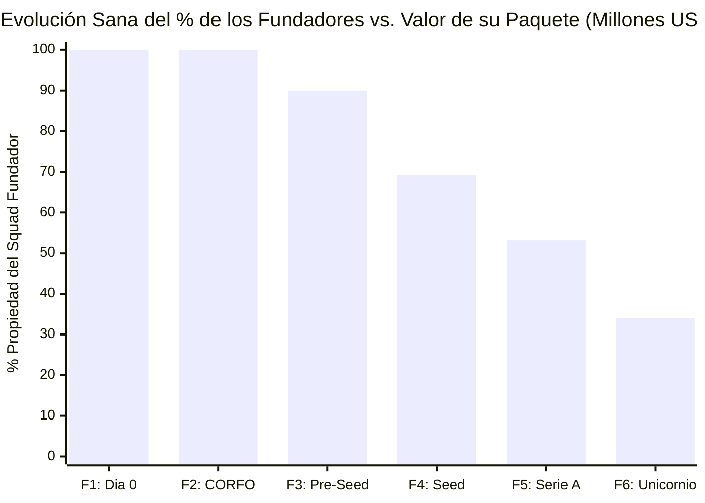
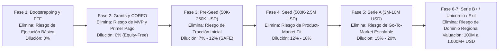
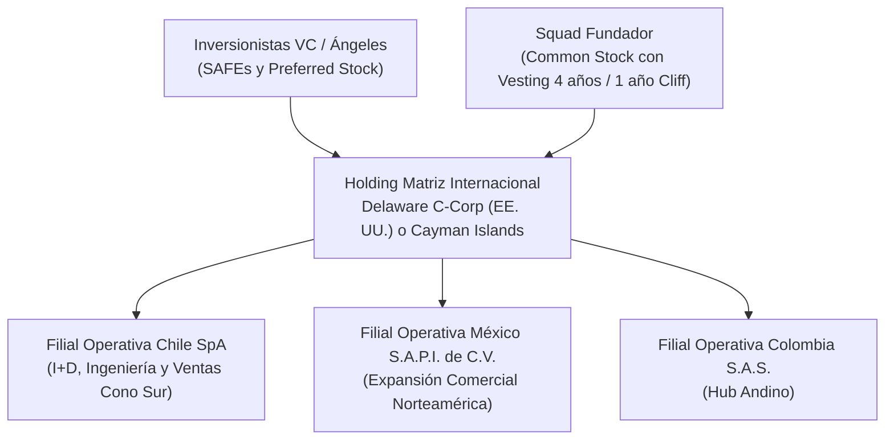

# TOMO IV: LA ESCALERA AL UNICORNIO
## De \$0 a \$1.000M USD, SAFEs y Cap Table
*Ingeniería financiera, fondos CORFO, Venture Capital y defensa patrimonial para fundadores en Latinoamérica*

---

## PRÓLOGO DEL TOMO IV: CÓMO GANAR EL JUEGO SIN PERDER TU EMPRESA

> **EL MANIFIESTO DE LA BIBLIA ÁGIL:**
> "El viejo Venture Capital murió. Durante veinte años te mintieron diciendo que para levantar capital necesitabas pasar seis meses diseñando un PowerPoint, quemar miles de dólares en agencias lentas y rogar por reuniones tomando café con inversionistas.
>
> Bienvenido a la era del **Vibe Coding y el Capital de Alta Velocidad**. Hoy, los equipos y *Squads* más ágiles del planeta no piden permiso ni levantan rondas con promesas vacías: despliegan arquitecturas serverless en producción en semanas, procesan pagos reales en vivo, automatizan su foso defensivo con agentes de IA y se sientan frente a CORFO, Ángeles y VCs con tracción irrefutable.
>
> Esta tetralogía no es un libro de lectura pasiva; es **La Biblia Operativa del Squad Moderno**. Es la metodología de levantamiento de capital para startups tecnológicas más ágil creada en la historia: un sistema diseñado para que equipos pequeños de alto rendimiento pasen de *localhost* a una valoración de Unicornio (\$1.000M+ USD) dominando el código, la dramaturgia escénica, los *unit economics* y la ingeniería financiera sin ceder el control de su compañía."

> [!NOTE]
> **DESCARGO DE RESPONSABILIDAD LEGAL Y FINANCIERA (LEGAL DISCLAIMER):**
> El contenido de este libro tiene fines estrictamente educativos, estratégicos y de referencia operativa bajo la metodología de **VibeCode Lab**. Ninguna sección, fórmula, ejemplo de contrato *Post-Money SAFE*, simulación societaria (*Delaware C-Corp / Cayman Sandwich*) o análisis de *Term Sheet* constituye asesoría legal, tributaria ni de inversión regulada. Antes de suscribir cualquier instrumento convertible, pacto de accionistas (*Shareholders' Agreement*) o reestructuración internacional (*Flip*), consulta siempre con abogados corporativos especializados en Venture Capital en tu jurisdicción aplicable.

Has llegado a la cumbre de **CÓDIGO & CAPITAL**.
En el **Tomo I**, desplegaste una arquitectura SaaS en producción digna de superar la auditoría técnica más hostil. En el **Tomo II**, construiste un pitch escénico de 180 segundos con demostración en vivo capaz de electrizar a cualquier jurado. En el **Tomo III**, instrumentaste la maquinaria financiera de tu negocio con *Unit Economics* de élite ($\text{LTV/CAC} > 3\times$, $\text{Payback} < 6\text{ meses}$ y $\text{NRR} > 110\%$).

Ahora enfrentas el desafío final: **la ingeniería del capital y la defensa de tu propiedad (*Equity*)**.

La historia de Latinoamérica está llena de tragedias silenciosas: fundadores brillantes que construyeron productos extraordinarios, facturaron millones de dólares y escalaron por todo el continente, pero que al momento de vender la compañía (*Exit*) descubrieron que eran dueños de menos del $3\%$ de las acciones ordinarias y que las cláusulas de liquidación preferente firmadas cinco años atrás dejaban sus bolsillos vacíos.

Peor aún: cientos de startups prometedoras mueren en la etapa Seed porque en su primer mes de vida le regalaron el $35\%$ o el $40\%$ de su empresa a un "inversionista tradicional" a cambio de \$25.000 USD, destruyendo para siempre su **Cap Table** (*Tabla de Capitalización*) y volviéndose "in-invertibles" (*Uninvestable*) ante cualquier fondo institucional serio como *Platanus Ventures*, *Y Combinator*, *Kaszek* o *Sequoia*.

Este cuarto y último volumen de **La Biblia del Squad Ágil** es tu escudo patrimonial y tu mapa de ruta desde \$0 hasta \$1.000.000.000+ USD de valoración. Aquí dominarás las 7 etapas del levantamiento de capital, cómo apalancar hasta \$100.000 USD de capital *Equity-Free* (0% dilución), la matemática exacta del **Post-Money SAFE**, la estructura internacional de expansión y el blindaje contra los 5 peligros mortales del Cap Table.

---

## ANTES DE EMPEZAR: DICCIONARIO RÁPIDO DE SIGLAS SOCIETARIAS Y DE CAPITAL (TOMO IV)
### *Para que negocies tu ronda, uses el simulador de SAFE y leas cualquier Term Sheet sin ser abogado*

Antes de firmar un solo documento o ceder un $1\%$ de tu compañía, asegúrate de dominar estas siglas que definen quién se queda con el control y con el dinero en un *Exit*:

| Sigla / Concepto | Nombre Completo | ¿Qué significa en 10 segundos y cómo protege tu bolsillo? |
| :--- | :--- | :--- |
| **`Equity`** | *Participación Accionaria / Propiedad* | El porcentaje de acciones de tu empresa. Ceder *equity* significa entregar un pedazo permanente de tu compañía. |
| **`Equity-Free`** | *Capital No Dilutivo (0% Acciones)* | Dinero que entra a tu empresa (subsidios CORFO, Start-Up Chile o créditos Cloud) sin que tengas que entregar ni una sola acción. |
| **`FFF`** | *Friends, Family & Fools* | Los primeros cheques pequeños de confianza de familiares, amigos o mentores en la etapa inicial. |
| **`Cap Table`** | *Capitalization Table* | La tabla oficial que muestra qué porcentaje exacto de la empresa tiene cada fundador, empleado e inversionista. |
| **`SAFE`** | *Simple Agreement for Future Equity* | Contrato estándar de 5 páginas creado por Y Combinator: recibes inversión hoy y se convierte en acciones en tu próxima ronda con precio. |
| **`Post-Money Cap`** | *Tope de Valoración Post-Money* | El techo máximo de valoración que fija un SAFE. Si levantas \$150K a un Cap Post-Money de \$1.5M, el inversor compra exactamente el $10\%$. |
| **`Discount Rate`** | *Tasa de Descuento del SAFE* | Descuento (usualmente $20\%$) sobre el precio por acción de la siguiente ronda si la valoración no supera el *Cap*. |
| **`Priced Round`** | *Ronda con Precio Fijo por Acción* | Ronda formal (típicamente Seed o Serie A) donde se emiten nuevas acciones preferentes a un precio fijo y se convierten los SAFEs. |
| **`Pre / Post-Money`** | *Valoración Antes y Después del Cheque* | $\text{Valuación Pre-Money} + \text{Nuevo Dinero Invertido} = \text{Valuación Post-Money}$. Tu dilución se calcula sobre el Post-Money. |
| **`ESOP`** | *Employee Stock Option Pool* | Reserva de acciones ($8\%$ a $12\%$) destinada a atraer y premiar a los empleados clave de la startup. |
| **`Vesting & Cliff`** | *Consolidación Gradual de Acciones* | Regla donde cada fundador o empleado "se gana" sus acciones mes a mes durante 4 años (*Vesting*), con un mínimo de 12 meses de permanencia (*Cliff*). |
| **`Corporate Flip`** | *Reestructuración a Holding Internacional* | Proceso legal donde tu empresa local (ej. SpA en Chile) pasa a ser filial 100% de una matriz en **Delaware C-Corp** o **Cayman** para recibir VC global. |
| **`Term Sheet`** | *Carta de Términos de Inversión* | Documento donde un fondo de Venture Capital resume la valoración y las reglas del juego antes de redactar los contratos definitivos. |
| **`1x Non-Participating`** | *Preferencia de Liquidación Limpia* | El estándar sano: al venderse la empresa, el inversor elige entre recuperar su inversión ($1\times$) **o** llevarse su porcentaje de acciones (nunca ambos). |
| **`Full Ratchet`** | *Cláusula Anti-Dilución Tóxica* | Cláusula venenosa que reprecia todas las acciones del inversor al precio más bajo si sufres un *Down Round*, destruyendo a los fundadores. |
| **`M&A / IPO / Exit`** | *Evento de Liquidez* | El momento en que la startup es comprada por un gigante (**M&A**) o sale a la bolsa (**IPO**), convirtiendo tus acciones en millones de dólares líquidos. |

---

## CAPÍTULO 1: LA FILOSOFÍA DEL DES-RIESGO ESCALONADO

### 1.1 El Capital de Riesgo No Ama el Riesgo: Ama la Eliminación Sistemática de Incertidumbre
Existe un mito urbano según el cual los inversionistas de Venture Capital son apostadores temerarios a los que les gusta el riesgo. Nada está más lejos de la realidad. El trabajo de un socio de VC consiste en **identificar asimetrías donde el fundador ya eliminó las capas más letales de riesgo** antes de pedir el cheque.

Cada vez que tu Squad sube un peldaño en la escalera del capital, lo que realmente ocurre a nivel económico es un intercambio: **tú eliminas una categoría específica de riesgo probándolo con código y tracción real, y el mercado financiero te recompensa multiplicando el precio de tu acción (menor dilución por cada dólar levantado)**.

### 1.2 Las 3 Capas de Riesgo que tu Squad Debe Destruir en Orden
1. **Riesgo Técnico y de Producto (*Can they build it?*):** En 2012 necesitabas \$300.000 USD para contratar a 6 ingenieros durante 10 meses y averiguar si el software podía construirse. En 2026, con la metodología de **VibeCode Lab**, un Squad de 2 a 3 personas elimina el 100% del riesgo técnico en **3 semanas** con un costo de infraestructura cercano a \$0 USD. **Regla absoluta: Jamás cedas ni un $0.1\%$ de equity para financiar la construcción del MVP inicial.**
2. **Riesgo de Mercado y Dolor (*Do people pay for it?*):** Se elimina hablando con usuarios reales, lanzando tu campaña de validación de \$10 USD en 48 horas y procesando tus primeras transacciones en vivo con llaves de producción (`APP_USR-`).
3. **Riesgo de Escalabilidad y Canal (*Can this become a \$100M ARR machine?*):** Se elimina demostrando que tus *Unit Economics* ($\text{LTV/CAC} > 3\times$, $\text{Payback} < 6\text{m}$ y $\text{NRR} > 110\%$) se mantienen intactos cuando pasas de invertir \$500 USD/mes a \$50.000 USD/mes en adquisición y expandes operaciones de Chile o Colombia hacia México y Brasil.

---

## CAPÍTULO 2: FASES 1 Y 2 — EL ARRANQUE SIN DILUCIÓN (BOOTSTRAPPING, FFF Y CAPITAL PÚBLICO EQUITY-FREE)

### 2.1 Fase 1: Bootstrapping, las 30 Entrevistas de Descubrimiento y la Regla de FFF
El primer peldaño de toda compañía legendaria se financia con el recurso más barato y soberano que existe: **el sudor intelectual de los fundadores (*Sweat Equity*) y los ingresos de tus primeros clientes**.

Antes de tocar la puerta de un inversionista o escribir una postulación de 40 páginas, tu Squad debe ejecutar el **Protocolo de Arranque en Frío de VibeCode Lab**:
1. **Las 30 Entrevistas bajo el Estándar de *The Mom Test*:** Habla con 30 tomadores de decisión del nicho objetivo sin mencionar tu idea durante los primeros 15 minutos. Pregunta cuánto dinero o cuántas horas perdieron la semana pasada por el problema que resuelves y qué herramienta están pagando hoy para parcharlo.
2. **Preventa y Cobro desde el Día 1:** Configura tu pasarela de Mercado Pago (Tomo I) y vende los primeros 5 a 10 accesos fundadores (*Founding Customers*). Incluso \$500 USD cobrados a desconocidos valen más en un Comité de Inversión que 50 diapositivas de estudio de mercado.
3. **Si recurres a *Friends, Family & Fools* (FFF) (\$5.000 a \$25.000 USD):**
   - Nunca fijes una valoración arbitraria baja ni entregues el 25% de la sociedad en una escritura tradicional por \$10.000 USD.
   - Si un familiar o mentor cercano aporta capital semilla inicial, instruméntalo siempre mediante un **SAFE sin tope con descuento (*Uncapped SAFE with 20% Discount*)** o con un *Valuation Cap* saludable ($\ge \$1.000.000\text{ USD}$), de modo que no contamine tu Cap Table para las rondas futuras.

### 2.2 Fase 2: El Arsenal de Capital Público *Equity-Free* en Latinoamérica y Créditos Cloud
Chile y Latinoamérica cuentan con uno de los ecosistemas de financiamiento público no dilutivo (*Equity-Free*, es decir, **0% de cesión de acciones**) más potentes del mundo. Un Squad disciplinado puede apalancar entre **\$20.000 USD y \$120.000 USD en subsidios directos** más **\$100.000 a \$250.000 USD en créditos de infraestructura Cloud e IA**, reteniendo el **100% de la propiedad de su empresa**.

#### Mapa Maestro de Fondos *Equity-Free* y Perks Tecnológicos (Edición 2026)

| Programa / Instrumento | Monto del Subsidio / Beneficio | Equity Cedido | Requisitos Clave para Ganar (Según el Tomo II) |
| :--- | :--- | :--- | :--- |
| **CORFO Semilla Inicia** (Chile) | **\$15.000.000 a \$17.000.000 CLP** (~$16K–$18.5K USD; +13% para empresas lideradas por mujeres) | **0% Equity** (Subsidio cofinanciado 75%–85%) | Innovación tecnológica clara, escalabilidad nacional/internacional, prototipo funcional en producción (`https://`) y video pitch de 180s cronometrado. |
| **CORFO Semilla Expande** (Chile) | **\$25.000.000 más extensión de \$20.000.000 CLP** (Hasta **\$45.000.000 CLP** / ~$48K USD) | **0% Equity** | Ventas reales facturadas y validadas, crecimiento sostenido de usuarios pagos y plan concreto de expansión comercial y nuevos mercados. |
| **Start-Up Chile (Build / Ignite / Growth)** | **\$15.000.000 CLP (Build)** / **\$30.000.000 CLP (Ignite)** / **\$75.000.000 CLP (Growth)** (~$80K USD) | **0% Equity** | Foco global desde el día 1, equipo con dedicación 100% full-time y tracción técnica y comercial demostrable. |
| **Programas Regionales LatAm** (*Innpulsa* Colombia, *ProInnóvate* Perú, *ANII* Uruguay) | **\$15.000 a \$60.000 USD** equivalentes en moneda local | **0% Equity** | Validación comercial temprana, componente de I+D / IA aplicada y generación de empleo calificado local. |
| **Créditos Cloud & AI Stack** (*AWS Activate*, *Google for Startups*, *Microsoft Founders Hub*, *Cloudflare Startup Program*) | **\$25.000 a \$250.000 USD** en créditos de cómputo GPU, APIs de OpenAI/Anthropic, bases de datos y CDN | **0% Equity** | Dominio corporativo propio (Tomo I), producto en vivo y afiliación a una incubadora, universidad o comunidad acreditada. |

> [!TIP]
> **Estrategia de Apalancamiento No Dilutivo de VibeCode Lab:**
> Si tu Squad gana **Semilla Inicia (\$17M CLP)**, activa **\$50.000 USD en créditos Cloud/IA** y seis meses después adjudica **Semilla Expande (\$45M CLP)** gracias a sus primeras ventas con Mercado Pago, habrás inyectado más de **\$115.000 USD de poder de fuego operativo** en tu compañía llegando a tu primera ronda privada con el **100.0% del Cap Table en manos de los fundadores**.

---

## CAPÍTULO 3: FASE 3 — RONDA PRE-SEED (\$50K–\$250K USD) Y DOMANDO EL POST-MONEY SAFE

### 3.1 Cuándo Abrir tu Ronda Pre-Seed y a Quién Apuntar
Una vez que tienes un MVP en producción con arquitectura profesional (Tomo I), tus primeros clientes pagando o un crecimiento semanal incipiente, y necesitas capital privado más mentoría estratégica para alcanzar el *Product-Market Fit*, entras en la **Fase 3: La Ronda Pre-Seed**.

En Latinoamérica, los jugadores clave de esta etapa son:
1. **Aceleradoras de Élite Basadas en Tesis de Fundadores Técnicos:**
   - **Platanus Ventures (Chile/LatAm):** Invierte típicamente **\$100.000 USD a \$150.000 USD** mediante un acuerdo estándar, conectándote en su Demo Day con los principales fondos de todo el continente y Silicon Valley.
   - **Y Combinator (San Francisco / Global):** El estándar de oro mundial. Invierte **\$500.000 USD** combinando un SAFE fijo con un SAFE con cláusula MFN (*Most Favored Nation*).
   - **500 Global LatAm / Techstars / Rockstart:** Tickets de \$60.000 USD a \$150.000 USD con fuerte red de distribución en México y Colombia.
2. **Inversionistas Ángeles Operadores (*Operator Angels*) y Sindicatos:**
   - Ex-fundadores de startups exitosas (ej. ex-ejecutivos de Cornershop, Buk, Kavak, Mercado Libre, Fintual o NotCo) que invierten cheques individuales de **\$5.000 USD a \$25.000 USD** y aportan acceso directo a clientes B2B.

### 3.2 Qué es el Post-Money SAFE y Por Qué Reemplazó a la Deuda Convertible
En el pasado, levantar \$100.000 USD requería redactar un aumento de capital complejo que tomaba 4 meses y \$8.000 USD en abogados, o firmar una **Nota Convertible** (deuda que devenga intereses y tiene una fecha de vencimiento o *Maturity Date* en la que el inversionista puede exigirte devolver el dinero o quebrar la empresa).

En 2013, **Y Combinator** creó el **SAFE (*Simple Agreement for Future Equity*)**, y en 2018 lo actualizó al estándar mundial actual: el **Post-Money SAFE**.
- **Un SAFE NO es deuda:** No tiene tasa de interés ni fecha de vencimiento (*Maturity Date*).
- **Es un contrato de 5 páginas:** El inversionista te transfiere el dinero hoy a cambio del derecho contractual a recibir acciones preferentes en el futuro, específicamente cuando tu startup levante su primera ronda con precio fijo (*Priced Equity Round*, típicamente en Serie Seed o Serie A).
- **Por qué se llama "Post-Money":** Porque permite tanto al fundador como al inversionista saber **exactamente y de forma inmediata qué porcentaje de la empresa está comprando el inversionista hoy**, antes de la dilución de la futura Serie A.

### 3.3 La Matemática Exacta del Post-Money SAFE: Valuation Cap vs. Discount Rate
El Post-Money SAFE opera mediante dos parámetros principales de protección para el inversionista temprano (pueden pactarse solo con *Cap*, solo con *Discount*, o ambos donde aplica el que resulte más favorable al inversionista al convertir):

1. **Valuation Cap (Tope de Valoración Post-Money):** Es el techo máximo de valoración al cual se convertirá el dinero del inversionista temprano, sin importar qué tan alta sea la valoración de tu futura ronda Seed o Serie A.
   - En Latinoamérica (2026), los **Valuation Caps Pre-Seed** para un Squad con producto en vivo y tracción inicial oscilan entre **\$1.000.000 USD y \$3.500.000 USD**.
   - **Fórmula de Propiedad Directa en un Post-Money SAFE:**

$$\text{Porcentaje del Inversionista SAFE (\%)} = \frac{\text{Monto Invertido en el SAFE}}{\text{Post-Money Valuation Cap}}$$

2. **Discount Rate (Tasa de Descuento, típicamente $15\%$ a $20\%$):** Si en tu siguiente ronda la valoración no supera significativamente el *Cap*, el inversionista convierte sus dólares con un descuento del $15\%$ o $20\%$ respecto al precio por acción que paguen los nuevos inversionistas de esa ronda.

#### Ejemplo Matemático Paso a Paso (Caso Práctico de Negociación):
Supongamos que tu Squad levanta **\$150.000 USD** en una ronda Pre-Seed mediante un **Post-Money SAFE** con un **Valuation Cap de \$1.500.000 USD** y un **Discount del 20%**.

1. **Dilución inmediata asegurada por el SAFE:**
   $$\text{Propiedad del Inversionista Pre-Seed} = \frac{\$150.000}{\$1.500.000} = 0.10 = \mathbf{10.0\%}$$
   Los fundadores conservan el **$90.0\%$** de la compañía antes de la siguiente ronda.

2. **Conversión 14 meses después en la Ronda Seed:**
   Catorce meses después, gracias a que multiplicaste tu MRR por $6\times$, un fondo regional lidera tu ronda **Seed** invirtiendo **\$1.000.000 USD** a una valoración **Pre-Money de \$5.000.000 USD** (Post-Money de \$6.000.000 USD).
   - Si el inversionista del SAFE usara su **20% de Descuento**, convertiría a una valoración equivalente de $\$5.000.000 \times (1 - 0.20) = \$4.000.000\text{ USD}$.
   - Si usa su **Valuation Cap**, convierte a **\$1.500.000 USD**.
   - Como **\$1.5M es menor que \$4.0M**, el inversionista del SAFE ejerce su **Valuation Cap**, cristalizando su **$10.0\%$** (su inversión de \$150.000 USD ahora vale nominalmente **\$500.000 USD** en papel, un retorno de $3.33\times$, mientras que los fundadores usaron esos \$150.000 USD para llevar la empresa a valer \$6.000.000 USD).

> [!CAUTION]
> **La Regla del 15% en Pre-Seed:**
> Como el Post-Money SAFE fija el porcentaje de cada cheque de forma aditiva ($\text{SAFE}_1 + \text{SAFE}_2 + \text{SAFE}_3$), **nunca emitas múltiples SAFEs que sumados superen el $15\%$ de dilución total en la fase Pre-Seed**. Si levantas \$100K a un Cap de \$1M (10%), luego otros \$100K a un Cap de \$1M (10%) y luego otros \$100K a un Cap de \$1.25M (8%), habrás entregado el **$28\%$ de tu empresa en Pre-Seed** antes siquiera de llegar a la ronda Seed.

---

## CAPÍTULO 4: FASE 4 — RONDA SEED (\$500K–\$2.5M USD) Y EL SANTO GRIAL DEL PRODUCT-MARKET FIT

### 4.1 Qué Exigen los Fondos Regionales de LatAm para Valorar tu Startup entre \$4M y \$10M USD
La **Ronda Seed** ya no se levanta con una promesa ni con un prototipo simpático; se levanta con evidencia empírica de **Product-Market Fit (PMF) temprano**.

Cuando te sientas con los socios de fondos institucionales líderes en Latinoamérica —como **Kaszek**, **Canary**, **Magma Partners**, **ALLVP**, **Cometa**, **Kayyak Ventures**, **Manutara Ventures**, **Nazca** o **Monashees**— para levantar entre **\$500.000 USD y \$2.500.000 USD** (a valoraciones Post-Money de **\$4.000.000 a \$10.000.000 USD**, cediendo entre el **$12\%$ y el $20\%$**), su comité auditará tres pruebas de fuego:

1. **Tracción Financiera Auditada (Tomo III):** Un **MRR entre \$10.000 USD y \$35.000 USD/mes** creciendo a un ritmo compuesto (**CMGR**) del **$15\%$ al $20\%$ mensual**, o bien un crecimiento explosivo de uso activo con *Unit Economics* positivos ($\text{LTV/CAC} > 3\times$ y $\text{Payback} < 6\text{ meses}$).
2. **Retención de Cohortes que se Aplana:** La curva de retención de tus cohortes no cae a cero en el mes 4, sino que se estabiliza horizontalmente (y en B2B muestra **NRR $> 105\%–110\%$** gracias a la expansión de cuentas).
3. **Tesis Creíble de Expansión Multinacional (El Salto a México, Colombia o Brasil):**
   - Chile, Uruguay o Costa Rica son **laboratorios de validación extraordinarios** por su bancarización digital, estabilidad institucional y talento de ingeniería.
   - Sin embargo, ningún fondo de Venture Capital puede devolver su fondo invirtiendo en una startup que solo operará en un mercado de 19 millones de habitantes. Tu ronda Seed debe financiar la conquista de un mercado de escala masiva: **México** (130M de habitantes y puerta de entrada a EE. UU. hispano), **Colombia / Región Andina** (52M+) o **Brasil** (215M+).

### 4.2 Arquitectura Societaria para VCs Internacionales: Delaware C-Corp y el *Cayman Sandwich*
Los fondos de Venture Capital estadounidenses y regionales no suelen invertir directamente en una *Sociedad por Acciones (SpA)* chilena, una *S.A.S.* colombiana ni una *S.A. de C.V.* mexicana, debido a complejidades de jurisdicción, impuestos de retención y gobierno corporativo.

Para recibir el cheque de tu ronda Pre-Seed internacional o Seed institucional, los abogados del fondo te pedirán ejecutar un **Corporate Flip** (reestructuración donde tu empresa operativa local pasa a ser 100% filial de un Holding matriz en el extranjero):

- **Opción 1: Delaware C-Corp (Estándar Y Combinator / Platanus / Fondos de EE. UU.):** Una corporación en el estado de Delaware (EE. UU.) que posee el 100% de tu SpA chilena y de tu futura filial en México. Es la estructura más rápida, barata de mantener y universalmente aceptada por SAFEs de YC.
- **Opción 2: Estructura *Cayman Sandwich* (Cayman Holding + Delaware LLC + Filiales LatAm):** Utilizada históricamente por grandes fondos latinoamericanos (*Kaszek*, *SoftBank LatAm*) para optimizar la tributación de ganancias de capital en un futuro *Exit* fuera de Estados Unidos.

> [!IMPORTANT]
> **El Vesting de los Fundadores (4 Años con 1 Año de Cliff):**
> Al firmar tu ronda Pre-Seed o Seed, todos los fundadores deberán someter sus propias acciones a un esquema de **Reverse Vesting de 48 meses con un *Cliff* de 12 meses**. ¿Qué significa esto? Que si dos cofundadores crean la empresa 50/50 y uno de ellos se cansa y abandona la startup al mes 6 (antes del *Cliff* de 12 meses), **se va con el $0\%$ de las acciones**. Si se va en el mes 24, solo consolida el $50\%$ de su paquete original (25% de la empresa) y el resto vuelve a la compañía para contratar a su reemplazo. Esta regla protege a los fundadores que sí se quedan construyendo la empresa durante 7 a 10 años.

---

## CAPÍTULO 5: FASES 5, 6 Y 7 — DE SERIE A AL ESTATUS UNICORNIO (\$1.000M+ USD) Y EXIT

### 5.1 Fase 5: La Serie A (\$3M a \$10M+ USD) — Escalando una Máquina Probada
Si la ronda Seed trata sobre **encontrar** el *Product-Market Fit*, la **Serie A** trata sobre **echarle combustible de avión a un motor comercial que ya funciona con precisión relojera**.

- **El Umbral Cuantitativo de la Serie A en 2026:** Cruzar entre **\$1.000.000 USD y \$3.000.000 USD de ARR** (es decir, **\$85.000 a \$250.000 USD de MRR**), creciendo al menos un **$100\%$ a $150\%$ interanual (YoY)**, con un **NRR $> 110\%$** y un **Burn Multiple $< 1.5\times$**.
- **Rango de Inversión y Valoración:** Levantas entre **\$3.000.000 USD y \$10.000.000 USD** a una valoración de **\$15.000.000 a \$45.000.000 USD**, emitiendo **Acciones Preferentes Serie A (*Series A Preferred Stock*)** con una dilución del **$15\%$ al $20\%$**, e integrando por primera vez un **Directorio Formal (*Board of Directors*)**.

### 5.2 Fases 6 y 7: Series B, C, D+, Estatus Unicornio (\$1.000M+ USD) y Liquidez (*Exit / M&A / IPO*)
A partir de la **Serie B y posteriores (\$15M a \$100M+ USD por ronda)**, tu compañía entra al radar de los mega-fondos globales de *Growth Equity* (**Sequoia Capital**, **Andreessen Horowitz (a16z)**, **General Catalyst**, **Tiger Global**, **SoftBank**, **QED Investors**, **Ribbit Capital**). El capital ya no se utiliza para probar si el producto funciona, sino para:
1. **Dominio Geográfico Continental:** Capturar el liderazgo indiscutido en México, Brasil, Colombia y Chile simultáneamente.
2. **M&A Ofensivo (Comprar Competidores):** Adquirir startups más pequeñas en mercados locales para absorber su cartera de clientes y su talento técnico.
3. **Expansión Multiproducto:** Pasar de ser una herramienta de un solo producto (*Single-Product SaaS*) a una plataforma integral (*Multi-Product Ecosystem*, integrando pagos embebidos, crédito B2B o infraestructura de agentes autónomos).

Cuando tu valoración supera los **\$1.000.000.000 USD (\$1 Billion USD)**, alcanzas el estatus de **Unicornio**. Finalmente, en la **Fase 7 (Liquidez / Exit)**, tanto los fundadores como los empleados (vía su *Option Pool / ESOP*) y los inversionistas convierten sus acciones en efectivo líquido mediante dos vías:
- **Adquisición Estratégica (M&A):** Una corporación tecnológica global compra el 100% de la compañía (como **Uber adquiriendo Cornershop**).
- **Oferta Pública Inicial (IPO):** La compañía sale a cotizar en la Bolsa de Nueva York (NYSE) o el NASDAQ (como **Nubank** o **Mercado Libre**).

### 5.3 Anatomía de Gigantes Reales nacidos en Chile y Latinoamérica

| Compañía | Origen y Sector | Hitos de Escalado y Capital | Lección Táctica para el Squad de VibeCode Lab |
| :--- | :--- | :--- | :--- |
| **Cornershop** *(Oskar Hjertonsson, Daniel Undurraga, Juan Pablo Cuevas)* | Chile / México — *On-Demand Grocery & Logistics Tech* | Rechazada inicialmente por un regulador para venderse a Walmart por \$225M USD; siguió ejecutando con disciplina implacable y terminó siendo **adquirida al 100% por Uber a una valoración de ~\$3.000.000.000 USD (\$3B USD)**. | **Ejecución binaria y enfoque México + Chile desde el día 1.** Un equipo fundador técnico obsesionado con la experiencia de usuario y los *unit economics* por pedido supera cualquier barrera regulatoria. |
| **Buk** *(Jaime Arrieta, Teresita Morán, Santiago Lira, Felipe Sateler)* | Chile / LatAm — *B2B SaaS WorkTech / HRTech* | Arrancó con foco extremo en rentabilidad y clientes reales antes de levantar grandes rondas con **Greenoaks, SoftBank y Kaszek**, superando los **\$850M+ USD de valoración** y expandiéndose a Colombia, Perú, México y Brasil. | **El poder del B2B SaaS con NRR $>115\%$ y disciplina de caja.** Buk demostró que resolver un dolor regulatorio y operativo denso (nómina y RR.HH.) con software superior crea un foso defensivo inexpugnable. |
| **NotCo** *(Matías Muchnick, Karim Pichara, Pablo Zamora)* | Chile / Global — *FoodTech & AI ("Giuseppe")* | Levantó con **Kaszek, Bezos Expeditions (Jeff Bezos), Tiger Global y L Catterton**, alcanzando estatus de **Unicornio (\$1.500M USD)** y cerrando *Joint Ventures* globales con Kraft Heinz. | **La IA propietaria como multiplicador de valoración.** No vendieron "mayonesa vegana"; vendieron un motor algorítmico de IA capaz de formular alimentos en una fracción del tiempo de la industria tradicional. |
| **Betterfly** *(Eduardo della Maggiora)* | Chile / LatAm — *InsurTech & B2B Benefits Platform* | Levantó Series A, B y C en tiempo récord con **QED Investors y Glade Brook**, convirtiéndose en el primer **Unicornio Social de LatAm (\$1.000M USD)**. | **Narrativa maestra + distribución B2B2C.** Cuando vendes a empresas (B2B) un producto que se despliega a miles de empleados (B2C), el crecimiento de usuarios se multiplica por cada contrato corporativo cerrado. |
| **Nubank** *(David Vélez, Cristina Junqueira, Edward Wible)* | Fundada por un colombiano en Brasil — *Fintech / Neobanco* | Respaldada por **Sequoia, Kaszek y Berkshire Hathaway (Warren Buffett)**; protagonizó un **IPO histórico en NYSE superando los \$45.000M–\$65.000M USD de capitalización bursátil**. | **Cero sucursales físicas, estructura de costos 100% software y obsesión por el NPS.** Cuando atacas a incumbentes lentos y caros en Latinoamérica con ingeniería de clase mundial, el tamaño del premio es global. |

---

## CAPÍTULO 6: LOS 5 PELIGROS MORTALES DEL CAP TABLE (Y CÓMO SOBREVIVIR A ELLOS)

Este capítulo puede ahorrarle a tu Squad millones de dólares y años de litigios societarios. Lee cada uno de estos cinco peligros antes de firmar cualquier documento con un inversionista.

### 6.1 Peligro Mortal #1: La Dilución Excesiva Temprana ("El Cap Table Roto")
El error número uno de los fundadores primerizos en Latinoamérica es aceptar el cheque de un empresario tradicional (del rubro inmobiliario, agrícola o comercio) que no entiende cómo funciona el Venture Capital y exige: *"Te pongo \$30.000 dólares hoy, pero somos socios 50/50 (o me das el 40% de la empresa)"*.

Si aceptas ese trato, **acabas de matar a tu startup**. ¿Por qué?
Porque un fondo institucional de Serie A sabe que a los fundadores todavía les quedan entre 5 y 7 años de trabajo extenuante para llevar la empresa a un *Exit*. Si los fundadores que trabajan 14 horas al día llegan a la Serie A o Serie B siendo dueños en conjunto de menos del **$40\%$ o $50\%$** de la compañía —mientras un socio pasivo que puso \$30.000 USD hace tres años y no escribe una línea de código es dueño del 40%—, **ningún fondo de Venture Capital invertirá en tu empresa**. En la jerga de Silicon Valley, tienes un **Dead Cap Table** (*Cap Table Muerto*).

**Regla de Supervivencia Patrimonial de VibeCode Lab:**
- Al cerrar **Pre-Seed**, los fundadores operativos deben retener entre el **$85\%$ y el $92\%$** de la compañía.
- Al cerrar **Seed**, los fundadores deben retener entre el **$68\%$ y el $78\%$**.
- Al cerrar **Serie A** (incluyendo la creación del *Option Pool / ESOP* del $10\%$ para empleados clave), los fundadores deben retener **más del $50\%$** de la propiedad total.

### 6.2 Peligro Mortal #2: El Valle de la Muerte entre Pre-Seed y Seed
El 75% de las startups que levantan una ronda Pre-Seed nunca logran cerrar su ronda Seed. ¿Por qué caen en este **Valle de la Muerte**?
Porque al recibir \$150.000 USD en el banco, cometen el pecado de **inflar prematuramente su *Burn Rate***: alquilan oficinas caras, contratan a un "VP de Ventas" corporativo, compran software innecesario y elevan su gasto mensual a \$25.000 USD/mes antes de haber encontrado el *Product-Market Fit*. Seis meses después se quedan sin caja y con un MRR estancado en \$3.000 USD/mes.

**Antídoto:** Mantén una estructura de costos de comando guerrillero (*Ramen Profitability*) con tu Squad técnico y agentes de IA hasta que tus *Unit Economics* ($\text{LTV/CAC} > 3\times$ y $\text{Payback} < 6\text{m}$) estén matemáticamente probados.

### 6.3 Peligro Mortal #3: Las Rondas Puente (*Bridge Rounds*) de Emergencia
Una **Ronda Puente (*Bridge Round*)** sana ocurre cuando estás a 90 días de alcanzar un hito gigantesco (ej. cerrar un contrato enterprise que duplicará tu ARR a \$1.2M USD) y tus inversionistas actuales te inyectan capital adicional para negociar una Serie A al doble de valoración.
Una **Ronda Puente de Emergencia** ocurre cuando quemaste toda la caja de tu ronda Seed, no cumpliste las métricas prometidas y vuelves a pedir dinero solo para pagar los sueldos del próximo mes. En el mercado actual, los fondos llaman a esto un *"Pier to Nowhere"* (un muelle hacia la nada) y suelen exigir recortes drásticos de valoración o negarse a seguir invirtiendo.

### 6.4 Peligro Mortal #4: La Trampa de la Valoración Inflada y el Terror del *Down Round*
Durante el frenesí del mercado, muchos fundadores celebran haber levantado una ronda Pre-Seed o Seed a una valoración artificialmente inflada (ej. levantar Seed a **\$25.000.000 USD de valoración** cuando apenas facturan \$4.000 USD de MRR).

¿Por qué una valoración demasiado alta sin sustento operativo es una trampa mortal?
Porque para que tu siguiente ronda sea un **Up Round** (ronda a mayor valoración), tendrás que justificar ante el mercado que tu empresa vale **\$50.000.000 USD**. Si 18 meses después facturas \$25.000 USD de MRR (que en condiciones normales sería un excelente resultado digno de una valoración de \$10M USD), ningún fondo nuevo te pagará \$50M USD. Te verás forzado a aceptar un **Down Round** (levantar capital a una valoración inferior a tu ronda previa, por ejemplo a \$10M USD en lugar de \$25M USD), lo que destruye la moral del equipo, deja las opciones de los empleados bajo el agua (*Underwater Options*) y dispara las cláusulas de castigo anti-dilución.

### 6.5 Peligro Mortal #5: Cláusulas Venenosas — Liquidación Preferente Múltiple y *Full Ratchet*
Un fundador inexperto solo mira el titular del *Term Sheet*: *"Me valoraron la empresa en \$10 millones de dólares"*. Un inversionista experimentado sabe que puede darte la valoración nominal que tú quieras si tú le permites escribir los términos de las cláusulas de protección (*Clean Terms vs. Dirty Terms*).

Existen dos cláusulas legales que debes auditar con lupa junto a tu abogado antes de firmar cualquier ronda:

#### A) Preferencia de Liquidación (*Liquidation Preference*): $1\times$ Non-Participating vs. $2\times$/$3\times$ Participating
La preferencia de liquidación define en qué orden se reparte el dinero si la empresa se vende (*Exit*).
- **El Estándar Limpio y Justo ($1\times$ *Non-Participating Preferred*):** Si un VC invierte \$2M USD por el 20% de tu empresa (valorada en \$10M USD) y mañana vendes la empresa por \$15M USD, el VC elige entre recuperar su inversión original ($1\times = \$2\text{M USD}$) **O** convertir sus acciones a ordinarias y llevarse su 20% (\$3M USD). Como \$3M > \$2M, se lleva \$3M USD y los fundadores se llevan los **\$12M USD restantes**.
- **La Cláusula Venenosa ($2\times$ o $3\times$ *Participating Preferred / Double Dip*):** Si firmas un $2\times$ *Participating*, ante la misma venta por \$15M USD, el inversionista **primero** saca dos veces su inversión ($2 \times \$2\text{M} = \$4\text{M USD}$) y **además** participa con su 20% sobre los \$11M USD restantes (+\$2.2M USD), llevándose \$6.2M USD y drenando el retorno de los fundadores. **Jamás aceptes múltiplos superiores a $1\times$ ni participación doble en rondas estándar.**

#### B) Cláusulas Anti-Dilución en caso de *Down Round*: *Broad-Based Weighted Average* vs. *Full Ratchet*
Si en el futuro sufres un *Down Round* (vendes acciones a un precio menor que en la ronda anterior), la cláusula anti-dilución protege a los inversionistas anteriores entregándoles acciones adicionales gratis (a costa de diluir a los fundadores):
- **El Estándar de Mercado (*Broad-Based Weighted Average*):** Ajusta el precio de conversión de forma proporcional y ponderada según la cantidad de dinero real emitido en la nueva ronda frente al tamaño total de la empresa. Es el estándar equilibrado y aceptado en Silicon Valley y LatAm.
- **La Cláusula Nuclear (*Full Ratchet*):** Establece que si vendes **incluso una sola acción** a mitad de precio en el futuro, **el 100% de las acciones de los inversionistas anteriores se reprecian automáticamente a ese precio mínimo**, pudiendo borrar de un plumazo la participación de los fundadores del 50% al 5%. **Trata la cláusula *Full Ratchet* como material radiactivo.**

---

## ANEXO SOCIETARIO: SIMULADOR MAESTRO DE CAP TABLE (DEL DÍA 0 A LA SERIE A)

Observa cómo evoluciona matemáticamente la propiedad (*Equity*) y el valor patrimonial en dólares de un Squad de 3 cofundadores que sigue al pie de la letra las reglas de **La Biblia del Squad Ágil**:

| Etapa de la Compañía | Capital Levantado | Valuación Post-Money | % Squad Fundador | % Ángeles / Pre-Seed (SAFE) | % VC Seed | % VC Serie A | % Option Pool (ESOP Talento) | Valor del Paquete de los Fundadores (USD) |
| :--- | :--- | :--- | :--- | :--- | :--- | :--- | :--- | :--- |
| **Fase 1: Constitución (Día 0)** | \$0 (Sweat Equity) | Nominal | **100.0%** | 0.0% | 0.0% | 0.0% | 0.0% | \$0 (En construcción) |
| **Fase 2: CORFO Semilla Inicia + Expande + Cloud** | **\$115.000 USD** (*Equity-Free*) | — | **100.0%** | 0.0% | 0.0% | 0.0% | 0.0% | **100% Soberanía** |
| **Fase 3: Ronda Pre-Seed (Post-Money SAFE)** | **\$150.000 USD** | **\$1.500.000 USD** (Cap) | **90.0%** | **10.0%** | 0.0% | 0.0% | 0.0% | **\$1.350.000 USD** |
| **Fase 4: Ronda Seed Institucional (+ ESOP 8%)** | **\$1.200.000 USD** | **\$8.000.000 USD** | **69.3%** | **7.7%** | **15.0%** | 0.0% | **8.0%** | **\$5.544.000 USD** |
| **Fase 5: Ronda Serie A (+ Top-up ESOP a 10%)** | **\$6.000.000 USD** | **\$30.000.000 USD** | **53.1%** | **5.9%** | **11.5%** | **20.0%** | **9.5%** | **\$15.930.000 USD** |
| **Fase 6/7: Serie B/C $\rightarrow$ Unicornio / Exit** | **\$50.000.000+ USD** | **\$1.000.000.000 USD** | **~34.0%** | ~3.8% | ~7.4% | ~42.8% (A+B+C) | ~12.0% | **\$340.000.000 USD** |

> **La Lección Matemática Definitiva:**
> Es infinitamente mejor ser dueño del **$34\%$ de una compañía de \$1.000.000.000 USD (\$340 millones de dólares para el Squad fundador)** que aferrarse por miedo al $100\%$ de un prototipo en `localhost` que factura \$0 USD, o regalar el $50\%$ el primer día y quedar fuera del juego antes de empezar.

---

## CHECKLIST DE BLINDAJE PATRIMONIAL DEL TOMO IV

Antes de firmar cualquier acuerdo societario o abrir tu ronda de inversión, verifica estos 5 candados:

- [ ] **1. Agotamiento de Vías *Equity-Free*:** Postulaste a fondos públicos sin dilución (CORFO Semilla Inicia/Expande, Start-Up Chile) y activaste tus créditos Cloud/IA antes de vender acciones para financiar gastos básicos.
- [ ] **2. Vesting de Fundadores Firmado (4 años / 1 año Cliff):** Ningún cofundador tiene acciones liberadas al 100% desde el día 1; el patrimonio de la empresa está protegido frente a salidas tempranas.
- [ ] **3. Control Estricto de Dilución en Pre-Seed ($\le 15\%$):** Tus contratos Post-Money SAFE están modelados en una hoja de cálculo y sabes exactamente qué porcentaje total representan al convertirse en tu ronda Seed.
- [ ] **4. Términos Limpios (*Clean Terms*):** Verificaste que tu *Term Sheet* tenga preferencia de liquidación **$1\times$ Non-Participating** y protección anti-dilución **Broad-Based Weighted Average** (jamás *Full Ratchet*).
- [ ] **5. Acreditación Pública de Squad Readiness (`SQR-2026-XXX`):** Tu equipo completó el diagnóstico integral de los 4 tomos y cuenta con su URL pública verificable (`/verify/[id]`) lista para incluir en la portada de su *Data Room* y *Deck* de inversión.

---

## ⚡ ACCIÓN FINAL DE LA TETRALOGÍA: OBTÉN TU ACREDITACIÓN DE DOMINIO (`SQR-2026-XXX`)

Has completado los cuatro volúmenes de **CÓDIGO & CAPITAL: La Biblia de los Squads Ágiles**. Ahora es el momento de certificar tu dominio de la tetralogía y pasar a la implementación real.

Escanea el código QR oficial del **Tomo IV** o haz clic en el enlace directo para ingresar al **Examen Interactivo de Lectura de VibeCode Lab (`/ebook-quiz`)**, superar el desafío del Tomo IV (o el Examen Maestro de los 4 Tomos) y emitir tu **Certificado Público de Dominio Editorial & Squad Readiness (`SQR-2026-XXX`)**:

- **Enlace de Enrutamiento Dinámico (QR):** [`https://www.javiermujica.com/go/4`](https://www.javiermujica.com/go/4)
- **Acceso Directo al Quiz del Tomo IV:** [`https://www.javiermujica.com/ebook-quiz?vol=4&utm_campaign=unicorn_bible`](https://www.javiermujica.com/ebook-quiz?vol=4&utm_campaign=unicorn_bible)

> *Al aprobar el examen en `/ebook-quiz`, recibirás tu diploma PDF de alta resolución con firma criptográfica, tu portal de verificación pública en `https://www.javiermujica.com/verify/[TU-ID]` y el acceso preferente para implementar tu SaaS junto a la Comunidad de VibeCode Lab.*
